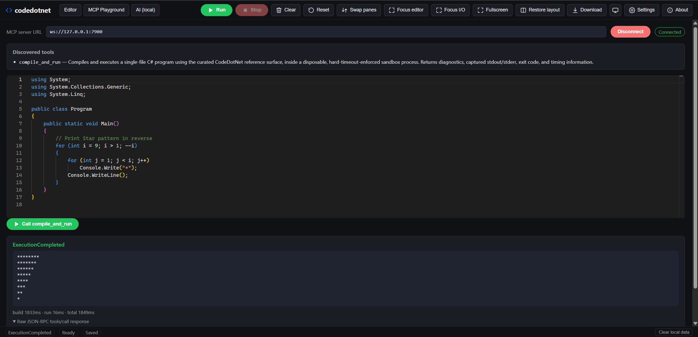
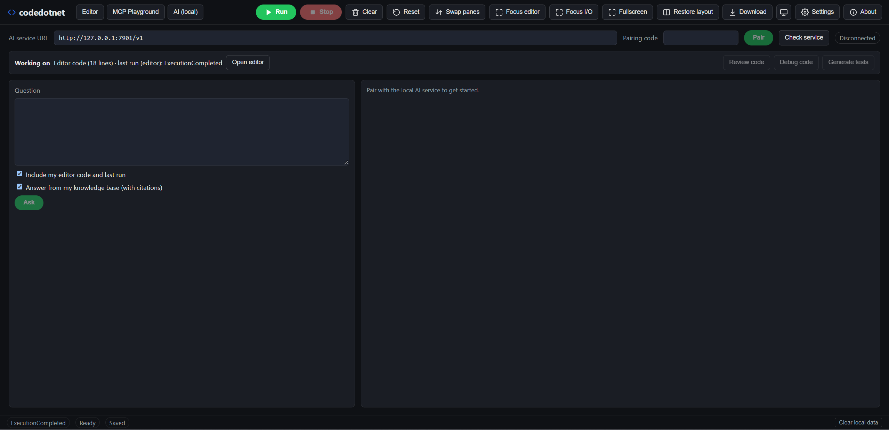
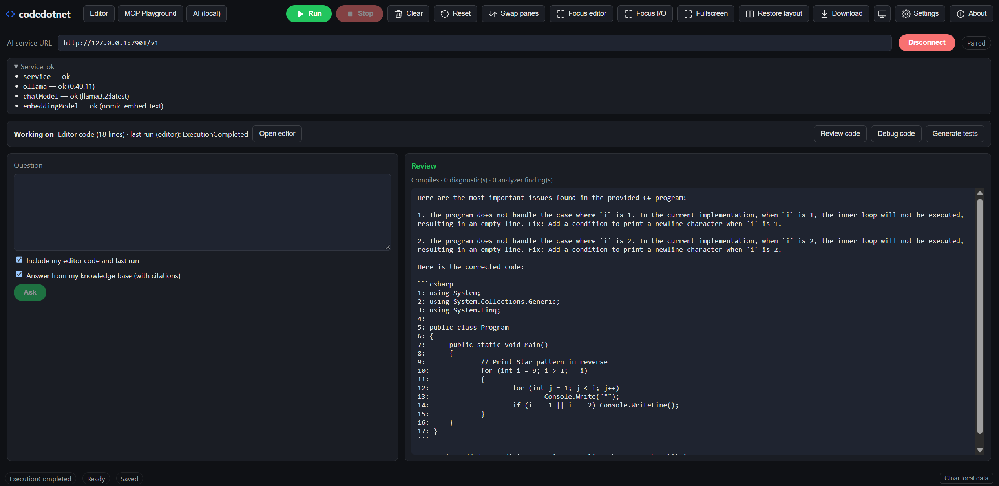
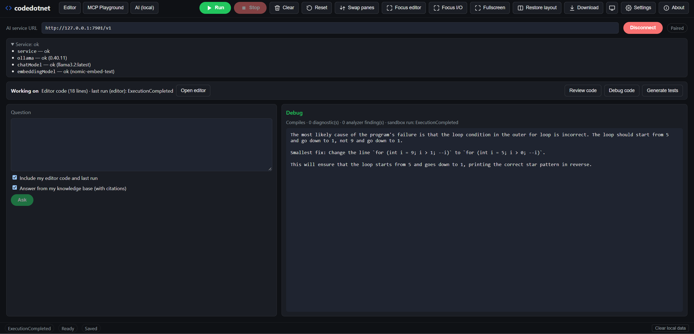
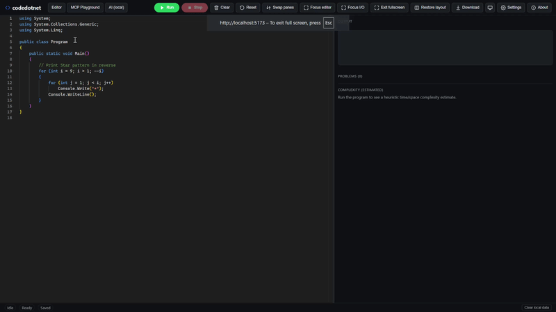

# 🧩 codedotnet

### A **local-first C# platform**. Write, compile and run C# in your browser with the **.NET 10 WebAssembly runtime** and **Roslyn**, expose the same runtime to AI tools through an **MCP server**, and add an optional **local AI assistant** (Ollama) that reviews, debugs, explains and writes tests for your code. No account, No Install, No Server, No Cloud.

[](https://dotnet.microsoft.com/download)
[](https://react.dev/)
[](https://www.typescriptlang.org/)
[](https://vitejs.dev/)
[](#-mcp-playground)
[-000?logo=ollama&logoColor=white)](#-local-ai-assistant)
[](#-how-rag-is-used)
[](#-how-rag-is-used)
[](#-how-rag-is-used)
[-0467DF?logo=meta&logoColor=white)](#-local-ai-assistant)
[](#-how-rag-is-used)
[](LICENSE)

**[🚀 Live demo (editor only) →](https://hunk7.github.io/codedotnet/)**

## ✨ What it does

| Capability | Details |
| --- | --- |
| 📝 **Editor** | Monaco-powered single-file `Program.cs` editor with C# highlighting, inline diagnostics and error navigation. |
| ▶️ **Run in the browser** | **Run** compiles and executes inside a dedicated Web Worker running Roslyn and the .NET WebAssembly runtime. Your code never leaves the browser. |
| ⌨️ **Output and timing** | Captured stdout/stderr, exceptions and compile / execute / total timings. |
| 📊 **Complexity estimate** | Automatic time/space Big-O estimate, with rationale, for the code you just ran. |
| 🛑 **Safe stop** | **Stop** hard-terminates a runaway program (for example an infinite loop) and starts a fresh worker. |
| 🔌 **MCP Playground** | A Model Context Protocol server exposing `compile_and_run` to VS Code, Claude Desktop, Cursor, Continue or any MCP client, plus an in-browser client. |
| 🤖 **Local AI assistant** | Review, debug, generate tests and ask questions about your code using a model on your own machine through Ollama. |
| 📚 **Knowledge base** | Optional retrieval over documents you add, with citations. |
| 🔒 **Local and private** | The AI service binds to loopback only, requires pairing, and keeps its token in browser memory only. |
| 💾 **Persistence** | Editor preferences, theme (light/dark/system) and layout are stored locally. |
| ⚡ **Shortcuts** | `Ctrl/Cmd+Enter` run, `Shift+F5` stop, `Ctrl/Cmd+S` save, `F11` fullscreen, plus Monaco Find/Replace and Undo/Redo. |

## 🧭 How the pieces fit together

```text
 Browser (http://localhost:5173)  ── codedotnet.web (React + TypeScript + Vite)
   ├─ Editor tab ........ runs C# in a Web Worker (Roslyn + .NET WASM)      [no server needed]
   ├─ MCP Playground .... WebSocket ─▶ codedotnet-sandbox  ws://127.0.0.1:7900   (Node.js)
   └─ AI (local) tab .... HTTP/SSE ──▶ CodeDotNet.Ai       http://127.0.0.1:7901/v1 (ASP.NET Core)
                                          ├─▶ Ollama                http://127.0.0.1:11434 (chat + embeddings)
                                          ├─▶ SQLite knowledge base (or optional Qdrant)
                                          ├─▶ Roslyn analysis (diagnostics + analyzer findings)
                                          └─▶ codedotnet-sandbox    (runs code and generated tests)
```

| Component | Port | Needed for |
| --- | --- | --- |
| `codedotnet.web` | 5173 | Everything (the UI) |
| `codedotnet-sandbox` | 7900 | MCP Playground, AI debug runs and AI test generation |
| `CodeDotNet.Ai` | 7901 | The AI tab |
| Ollama | 11434 | AI answers, reviews, debugging and tests |

The editor works on its own. MCP and AI are optional layers on top. To run the whole system, including the MCP sandbox and the local AI assistant, follow [docs/local-stack.md](docs/local-stack.md).

## 🚦 Quick start: editor only

Prerequisites: [.NET 10 SDK](https://dotnet.microsoft.com/download) and
[Node.js 22+](https://nodejs.org/).

```powershell
git clone https://github.com/hunk7/codedotnet.git
cd codedotnet/codedotnet.web
npm install

# Publish the compiler worker once so the frontend can load it locally
npm run build:worker

npm run dev
```

Open the printed URL (normally <http://localhost:5173>), edit the sample and press **Run**.

Production build (as used for GitHub Pages):

```powershell
cd codedotnet.web
npm run build:worker:release
npm run build
```

## 🧑‍💻 Using the application

### Editor tab

Write C# in `Program.cs` and click **Run** (`Ctrl/Cmd+Enter`). The output
pane shows stdout, diagnostics, exceptions, timings and the complexity estimate. Use **Swap panes**,
**Focus editor**, **Focus I/O** and **Fullscreen** to arrange the workspace.


### MCP Playground tab

Click **Connect** (default `ws://127.0.0.1:7900`), pick `compile_and_run`, edit the program and
call the tool. The tab shows the parsed result and the raw JSON-RPC response. The source is shared
with the Editor tab, so code you write in either place is the same program. The full
[MCP Playground](#-mcp-playground) section below has a screenshot.



### AI (local) tab

Everything on this tab works on the code in your editor and the result of the **last run**, whether
that run happened in the Editor tab or in the MCP Playground. The banner at the top shows what the
AI is working on, for example `Editor code (18 lines) · last run (MCP): BuildFailed`.

#### AI tab overview

Pair with the local service, check its health, then choose an action. The tab works on your
editor code and last run.



#### Review code

**Review code** combines Roslyn diagnostics and analyzer findings with a model review of your program.



#### Debug code

**Debug code** runs the program in the sandbox and explains failures using the real compiler errors, exceptions and output.



#### Actions reference

| Action | What it does |
| --- | --- |
| **Review code** | Roslyn diagnostics and analyzer findings plus a model review of your program. |
| **Debug code** | Compiles and runs the program in the sandbox, then explains failures using the real compiler errors, exceptions and output. |
| **Generate tests** | Writes a self-contained test harness, compiles and runs it in the sandbox, and retries with the failure output (up to 3 attempts). Reports whether the tests passed. |
| **Ask** | A free-form question. Tick **Include my editor code and last run** to attach your code and last result, and **Answer from my knowledge base (with citations)** to ground the answer in documents you added. |

Tips:

- Fix compile errors first. Test generation requires code that compiles.
- Larger models give noticeably better reviews and tests. Small models can produce invalid tests.
- The first request after startup is slower because the model has to load into memory. Later
  requests are much faster while the model stays loaded.

## 🔌 MCP Playground

The `codedotnet-sandbox/` Node.js server exposes `compile_and_run` as an
[MCP](https://modelcontextprotocol.io/) tool over **stdio** and **WebSocket**. Every call runs in a
disposable child process with a hard timeout, reusing the same `CodeDotNet.Engine` WebAssembly
artifact as the browser.


Run only the sandbox and the web app:

```powershell
# Terminal 1: MCP WebSocket server (ws://127.0.0.1:7900)
cd codedotnet-sandbox
npm install
npm run serve

# Terminal 2: web app
cd codedotnet.web
npm install
npm run dev
```

> ⚠️ The **GitHub Pages demo** is static and cannot host the sandbox, so the MCP tab shows
> **Disconnected** until you run the sandbox locally. To use the hosted site with your local
> sandbox, start it with the Pages origin allowed (see
> [GitHub Pages deployment](docs/deployment.md#hosted-site-and-the-local-ai-tab)). See
> [`codedotnet-sandbox/README.md`](codedotnet-sandbox/README.md) for the stdio transport, isolation
> model and how to register the server with VS Code, Claude Desktop, Cursor and Continue.

## 🤖 Local AI assistant

`CodeDotNet.Ai` is an ASP.NET Core service that talks to Ollama. It is designed to be local-first:

- Binds to `127.0.0.1` only and rejects non-loopback origins.
- Protected routes need a bearer token obtained by pairing. Tokens last 8 hours and are kept in
  browser memory only.
- No cloud calls and no telemetry.
- Chooses a resource profile from your hardware (`low-resource` or `recommended`) and keeps model
  context and output sizes bounded.

API summary (base URL `http://127.0.0.1:7901/v1`):

| Route | Purpose |
| --- | --- |
| `GET /health` | Service, Ollama, chat model and embedding model status (open) |
| `POST /pair` | Exchange the pairing code for a token (open) |
| `POST /ask` | Streamed answer, optionally grounded in the knowledge base |
| `POST /review`, `/debug`, `/tests` | Code workflows (streamed) |
| `POST/GET/DELETE /kb/documents` | Manage knowledge-base documents |
| `POST /agent/runs` | Bounded agent runs |

Full details: [`docs/ai/api.md`](docs/ai/api.md).

### Why does the status say "degraded"?

`degraded` means the service works but something optional is missing. The most common cause is the
embedding model: run `ollama pull nomic-embed-text` and click **Check service**. Without it, the
knowledge base uses keyword search instead of semantic search; chat, review, debug and tests are
not affected.

## 📚 How RAG is used

The **Ask** action can answer from documents you add to a local knowledge base (retrieval-augmented
generation). Documents are chunked, indexed by keyword (SQLite FTS5) and by embedding
(`nomic-embed-text`), and the best passages are given to your local model as numbered evidence. The
model must cite them, and the service **checks every citation** against the evidence it supplied.
If nothing relevant is found, the model is not called and the answer says so.

| Step | What happens |
| --- | --- |
| Ingest | `POST /v1/kb/documents` splits the text by Markdown headings and code fences (about 1,200 characters per chunk). |
| Retrieve | Keyword and vector results are merged. A chunk needs keyword support or a minimum vector similarity. |
| Ground | The top chunks are sent as untrusted, numbered evidence with an "answer only from this" instruction. |
| Validate | `[n]` citations in the answer are matched to the supplied evidence and streamed as `citation` events. |
| Fall back | If embeddings are unavailable, retrieval continues keyword-only and the result says so. |

**What it outputs.** Real output from a local run, with `docs/ai/rag-design.md` in the knowledge base.
Question: *What happens when the vector store or embeddings fail during retrieval?*

```text
Answer (streamed token by token):
  According to the evidence passage [1], when the vector store or embeddings fail during
  retrieval, the service continues lexical-only retrieval.

event: citation
data: {"label":1,"chunkId":"d-f195fccca22d-0","source":"docs/ai/rag-design.md","title":"rag-design.md","heading":"RAG Design"}

event: done
data: {"outcome":"ok","stopReason":"complete","grounded":true,"citations":1,"invalidCitations":[],"usedVectors":true,"note":null}
```

An out-of-scope question (*How do I bake a sourdough loaf?*) is not guessed at:

```text
I could not find evidence for this in your knowledge base, so I will not guess.

event: done
data: {"outcome":"ok","stopReason":"insufficient_evidence","grounded":false,"note":null}
```

Full walkthrough, limits and a try-it-yourself example: [`docs/ai/rag.md`](docs/ai/rag.md).

## ⚙️ Configuration

The AI service reads the `Ai` configuration section. Set values with environment variables
(`Ai__ChatModel=...`) or command-line arguments (`--Ai:ChatModel=...`).

| Setting | Default | Purpose |
| --- | --- | --- |
| `Ai:Port` | `7901` | AI service port (loopback) |
| `Ai:OllamaBaseUrl` | `http://127.0.0.1:11434` | Ollama endpoint |
| `Ai:Profile` | auto | `low-resource` or `recommended` |
| `Ai:ChatModel` | from profile | Force a specific chat model |
| `Ai:EmbeddingModel` | `nomic-embed-text` | Embedding model |
| `Ai:GpuMode` | `Auto` | `Off`, `Auto` or `On` |
| `Ai:SandboxUrl` | `ws://127.0.0.1:7900` | Sandbox used for debug runs and test generation |
| `Ai:VectorStore` | `sqlite` | `sqlite` or optional `qdrant` |
| `Ai:DataDirectory` | `%LOCALAPPDATA%\CodeDotNet\ai` | Where the knowledge base is stored |
| `Ai:AllowedOrigins` | loopback only | Extra allowed browser origins |

Resource profiles:

| Profile | Chat model | Typical hardware |
| --- | --- | --- |
| `low-resource` | `qwen2.5-coder:1.5b` | Less than 24 GB RAM or fewer than 8 cores |
| `recommended` | `qwen2.5-coder:7b` | 24 GB+ RAM and 8+ cores |

More: [`docs/ai/hardware-and-resource-profiles.md`](docs/ai/hardware-and-resource-profiles.md).

## ✅ Health checks, tests and validation

```powershell
# .NET (AI service + engine)
dotnet build codedotnet.slnx
dotnet test codedotnet.slnx

# Frontend
cd codedotnet.web
npm run typecheck
npm run lint
npm run format:check
npm test
npm run build

# MCP sandbox
cd ../codedotnet-sandbox
npm test

# Running stack
scripts/dev/Test-CodeDotNetHealth.ps1   # sandbox + AI service reachable
scripts/dev/Test-CodeDotNetSmoke.ps1    # pairing, auth, origin and knowledge-base round trip
```

The smoke script reads the pairing code from `.codedotnet/logs/ai.out.log`, which is valid for
30 minutes. Restart the stack if it has expired. More: [`docs/testing.md`](docs/testing.md).

## 🛠️ Troubleshooting

| Symptom | Fix |
| --- | --- |
| `provider_error ... 404` | The model is not installed. Run `ollama list`, then `ollama pull qwen2.5-coder:7b` (or set `Ai:ChatModel` to an installed model). |
| Status shows `degraded` | Usually the embedding model: `ollama pull nomic-embed-text`. |
| "Invalid pairing code" | Copy the newest `Pairing code` line from the console or `.codedotnet/logs/ai.out.log`. Codes last 30 minutes. |
| Test generation fails or loops | Use a coder model, make sure the code compiles, and make sure the sandbox is running on port 7900. |
| MCP tab shows Disconnected | Start the sandbox (`npm run serve` in `codedotnet-sandbox`) and make sure worker assets exist (`npm run build:worker`). |
| First AI answer is slow | The model is loading. Later answers are faster. Use the `low-resource` profile on small machines. |
| Port 7900, 7901 or 5173 in use | Stop the other process or run `scripts/dev/Stop-CodeDotNet.ps1`. |
| PowerShell blocks scripts | Run `powershell -ExecutionPolicy Bypass -File scripts/dev/Start-CodeDotNet.ps1` for that process only. |

More: [`docs/ai/troubleshooting.md`](docs/ai/troubleshooting.md).

## 🗂️ Repository layout

| Path | Purpose |
| --- | --- |
| `codedotnet.web/` | React + TypeScript + Vite frontend (editor, MCP Playground, AI tab, worker manager). |
| `codedotnet.compiler/` | .NET 10 `browser-wasm` project: Roslyn compile host, execution host, JS interop. |
| `CodeDotNet.Engine/` | Shared compile-and-run engine used by the browser worker and the sandbox. |
| `CodeDotNet.Engine.Tests/` | xUnit tests for the engine, run natively. |
| `CodeDotNet.Contracts/` | Shared request/response contracts. |
| `CodeDotNet.Ai/` | Local AI service (ASP.NET Core): pairing, Ollama provider, RAG, review/debug/tests workflows. |
| `CodeDotNet.Ai.Abstractions/` | Provider, profile and vector-store abstractions. |
| `CodeDotNet.Ai.Tests/` | xUnit tests for the AI service (uses fake providers, no Ollama needed). |
| `codedotnet-sandbox/` | Node.js MCP server: stdio and WebSocket transports for `compile_and_run`. |
| `scripts/` | Worker build scripts and `scripts/dev/` start, stop, health, smoke and publish scripts. |
| `.github/` | CI validation, GitHub Pages deployment and Dependabot. |
| `docs/` | Architecture, testing, deployment, security, privacy, AI docs, ADRs and media. |

## 📖 Documentation

- 🏗️ [`docs/architecture.md`](docs/architecture.md): system architecture and component responsibilities.
- 🤖 [`docs/ai/README.md`](docs/ai/README.md): local AI documentation index (setup, API, RAG, agents, security).
- 🏗️ [`docs/local-stack.md`](docs/local-stack.md): build and run the full local stack step by step.
- 📚 [`docs/ai/rag.md`](docs/ai/rag.md): how RAG is used, with real output.
- 🖥️ [`docs/ai/local-setup.md`](docs/ai/local-setup.md): Windows setup and manual validation.
- 🧪 [`docs/testing.md`](docs/testing.md): how to run each test suite.
- 🚀 [`docs/deployment.md`](docs/deployment.md): CI/CD, GitHub Pages deployment and using the hosted site with your local AI.
- 🌍 [`docs/custom-domains.md`](docs/custom-domains.md): DNS/CNAME guidance.
- 🔒 [`docs/security.md`](docs/security.md): CSP, sandboxing model, dependency scanning.
- 🕵️ [`docs/privacy.md`](docs/privacy.md): what happens to your code.
- ⚠️ [`docs/known-limitations.md`](docs/known-limitations.md): single-file constraint, no NuGet restore, browser limits.
- 📝 [`docs/adr/`](docs/adr/README.md): Architecture Decision Records (ADR-001 to ADR-015).
- 🧩 [`codedotnet-sandbox/README.md`](codedotnet-sandbox/README.md): MCP server details and client registration.
- 🖥️ [`codedotnet.web/README.md`](codedotnet.web/README.md): frontend development.
- ©️ [`THIRD-PARTY-NOTICES.md`](THIRD-PARTY-NOTICES.md): third-party license notices.

## 🎬 Demo video

A full walkthrough of the running application: the editor, the MCP Playground and the local AI
assistant (pairing, review, debug, test generation and questions about your code).

<p align="center">
  
</p>

## 📜 License

MIT. See [`LICENSE`](LICENSE).
