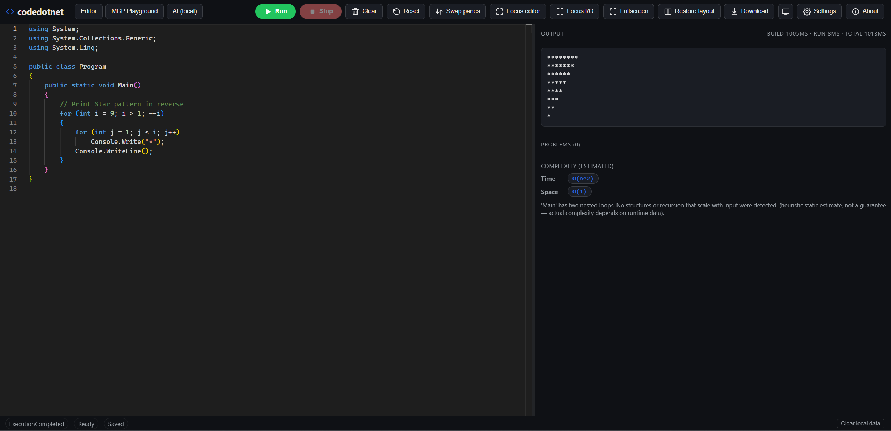
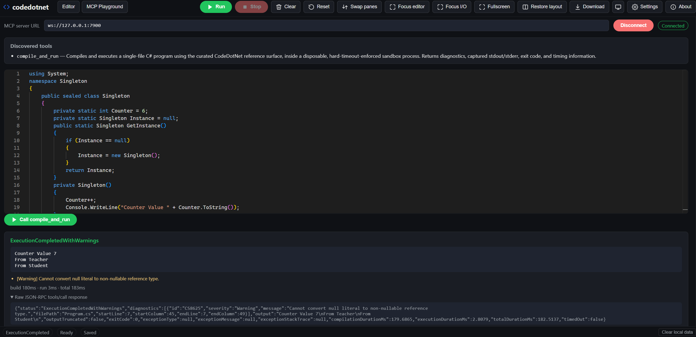

# 🧩 codedotnet

> A browser-based C# playground — write, compile, and run C# entirely client-side using the
> **.NET 10 WebAssembly runtime** and **Roslyn**. No server. No account. No install.

[](https://dotnet.microsoft.com/download)
[](https://react.dev/)
[](https://www.typescriptlang.org/)
[](https://vitejs.dev/)
[](#-mcp-playground)
[](LICENSE)
[](https://pages.github.com/)

**[🚀 Live demo →](https://hunk7.github.io/codedotnet/)**

> 🔌 Also includes an **[MCP Playground](#-mcp-playground)** — a Model Context Protocol server + in-browser client that exposes `compile_and_run` as a tool for VS Code, Claude Desktop, and any other MCP-aware client.



---

## ✨ What it does

|     |                                                                                                                                                                                   |
| --- | --------------------------------------------------------------------------------------------------------------------------------------------------------------------------------- |
| 📝  | Monaco-powered editor for a single `Program.cs` file with C# syntax highlighting, inline diagnostics, and error navigation.                                                       |
| ▶️  | Click **Run** to compile and execute your code inside a dedicated Web Worker running Roslyn and the .NET WebAssembly runtime, entirely in your browser.                           |
| ⌨️  | Supply buffered STDIN before running, and see captured stdout/stderr, exceptions, and timing breakdowns (compile / execute / total) in the output pane.                           |
| 📊  | Automatic **time/space Big-O complexity estimate** (with rationale) for the code you just ran.                                                                                    |
| 🧱  | Resizable, swappable editor/I-O panes, focus modes, and fullscreen support.                                                                                                       |
| 💾  | Editor preferences, theme (light/dark/system), and layout are persisted locally so your workspace is restored next time you visit.                                                |
| ⚡  | Keyboard shortcuts: `Ctrl/Cmd+Enter` to run, `Shift+F5` to stop, `Ctrl/Cmd+S` to force-save locally, `F11` to toggle fullscreen, plus Monaco's native Find/Replace and Undo/Redo. |
| 🛑  | Graceful recovery from runaway programs (e.g. infinite loops): **Stop** hard-terminates the worker and a fresh one takes its place.                                               |
| 🌐  | A clear "unsupported browser" message if required capabilities (WebAssembly, Web Workers, Blob URLs, local storage) are missing, instead of a silent failure.                     |

## 🔌 MCP Playground

codedotnet also ships a [Model Context Protocol (MCP)](https://modelcontextprotocol.io/) server
(`codedotnet-sandbox/`) that exposes the exact same `compile_and_run` capability as a tool any
MCP-aware client (VS Code, Claude Desktop, or the browser) can call — reusing the same
`CodeDotNet.Engine`-backed WebAssembly artifact as the main playground, but isolated per-call in a
disposable, hard-timeout-enforced child process.

The **MCP Playground** tab in the web app is an in-browser client for this server over a
WebSocket transport. The hosted [GitHub Pages site](https://hunk7.github.io/codedotnet/) defaults
to a free, publicly-hosted instance at `wss://codedotnet-sandbox.onrender.com` (deployed on
[Render](https://render.com)'s free tier — see
[`docs/deployment-mcp-sandbox.md`](docs/deployment-mcp-sandbox.md)). Since it's a free-tier
service, it sleeps after ~15 minutes of inactivity, so the first connection after idle time can
take up to a minute to wake up; the UI surfaces a hint for this. You can switch the **MCP server
URL** field to `ws://127.0.0.1:7900` to connect to a local sandbox instead (instant, no cold start):



| | |
| --- | --- |
| 🔗 | Connect to any MCP WebSocket endpoint (defaults to the public Render-hosted sandbox) and see its **Connected**/**Disconnected** status live. |
| 🧰 | **Discovered tools** panel lists every tool the server advertises via `tools/list`, with its description. |
| 📝 | Edit a single-file C# program in the same Monaco-powered editor used by the main playground. |
| ▶️ | **Call compile_and_run** invokes the tool over JSON-RPC 2.0 and renders the parsed result: status (e.g. `ExecutionCompleted`, `ExecutionCompletedWithWarnings`), captured stdout, diagnostics/warnings with file/line/column, and a `build / run / total` timing breakdown. |
| 🔍 | A collapsible **Raw JSON-RPC tools/call response** section shows the exact wire payload for debugging or integrating your own MCP client. |

To try it locally (against your own sandbox instance, instead of the public Render deployment):

```powershell
# Terminal 1: start the MCP WebSocket server (ws://127.0.0.1:7900)
cd codedotnet-sandbox
npm install
npm run serve

# Terminal 2: start the web app
cd codedotnet.web
npm install
npm run dev
```

Open the printed dev server URL, switch to the **MCP Playground** tab, change the **MCP server
URL** field to `ws://127.0.0.1:7900`, click **Connect**, and run the sample program. See
[`codedotnet-sandbox/README.md`](codedotnet-sandbox/README.md) for the stdio transport, worker-pool
isolation model, and instructions for registering the server with VS Code or Claude Desktop. See
[`docs/deployment-mcp-sandbox.md`](docs/deployment-mcp-sandbox.md) for how the public Render
instance is deployed and operated.

## 🚦 Quick start

Prerequisites: [.NET 10 SDK](https://dotnet.microsoft.com/download) and
[Node.js 22+](https://nodejs.org/).

```powershell
# Frontend (dev server with hot reload)
cd codedotnet.web
npm install
npm run dev

# Publish the compiler worker once so the frontend can load it locally
npm run build:worker
```

Then open the printed local URL in your browser.

To produce a production build (as used for GitHub Pages deployment):

```powershell
cd codedotnet.web
npm run build:worker:release
npm run build
```

## 🗂️ Repository layout


| Path                              | Purpose                                                                                   |
| --------------------------------- | ----------------------------------------------------------------------------------------- |
| 🖥️ `codedotnet.web/`              | React + TypeScript + Vite frontend (editor, shell, worker manager, complexity estimator). |
| ⚙️ `codedotnet.compiler/`         | .NET 10 `browser-wasm` project: Roslyn compile host, execution host, JS interop.          |
| ✅ `codedotnet.compiler.tests/`   | xUnit tests for the compiler/execution host logic (linked source, runs natively).         |
| 🧰 `codedotnet-sandbox/`           | Node.js MCP server: stdio + WebSocket transports for a sandboxed `compile_and_run` tool. |
| 🤖 `.github/workflows/deploy.yml` | CI validation + GitHub Pages deployment workflow.                                         |
| 📦 `.github/dependabot.yml`       | Automated weekly dependency updates (npm, NuGet, GitHub Actions).                         |
| 📚 `docs/`                        | Architecture, testing, deployment, security, privacy, limitations, and ADRs.              |

## 📖 Documentation

- 🏗️ [`docs/architecture.md`](docs/architecture.md) — system architecture and component responsibilities.
- 🧪 [`docs/testing.md`](docs/testing.md) — how to run and what each test suite covers.
- 🚀 [`docs/deployment.md`](docs/deployment.md) — CI/CD and GitHub Pages deployment flow.
- 🌍 [`docs/custom-domains.md`](docs/custom-domains.md) — DNS/CNAME guidance for custom domains.
- 🔒 [`docs/security.md`](docs/security.md) — Content-Security-Policy, sandboxing model, dependency scanning.
- 🕵️ [`docs/privacy.md`](docs/privacy.md) — what happens to your code, and how to verify it yourself.
- ⚠️ [`docs/known-limitations.md`](docs/known-limitations.md) — buffered STDIN, single-file constraint, no NuGet restore, browser resource limits.
- 📝 [`docs/adr/`](docs/adr/) — Architecture Decision Records (ADR-001 through ADR-008).
- 🧩 [`codedotnet-sandbox/README.md`](codedotnet-sandbox/README.md) — MCP server: architecture, isolation model, tool contract, and MCP client registration.
- ©️ [`THIRD-PARTY-NOTICES.md`](THIRD-PARTY-NOTICES.md) — third-party license notices.

## 📜 License

MIT — see [`LICENSE`](LICENSE).
