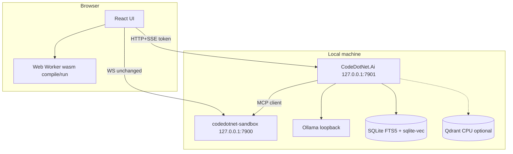
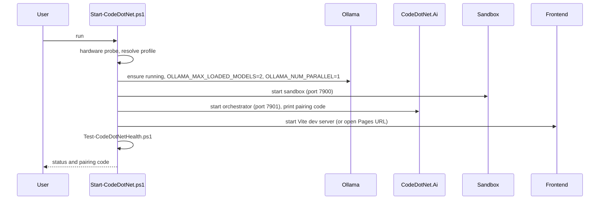

# CodeDotNet Local-First AI: Master Implementation Plan

Status: **Proposed. Documentation only. No AI phase is implemented or approved for implementation.**
Branch: `codedotnet-mcp-platform`.
Evidence labels: **[V]** verified in source, **[P]** proposed, **[A]** assumption, **[R]** risk, **[D]** decision, **[Q]** open question.

Related: [`../context/`](../context/project-overview.md), [`feasibility.md`](feasibility.md), [`requirements-traceability.md`](requirements-traceability.md), [`plan-validation-report.md`](plan-validation-report.md), ADRs [009](../adr/009-local-first-ai-runtime.md) to [015](../adr/015-local-resource-profiles-and-startup.md).

---

## 1. Executive summary

CodeDotNet is a static browser C# playground with a separate local Node MCP sandbox [V]. This plan adds optional, local-first AI assistance (grounded Q&A, code review, debugging, test generation, bounded agent) through a new native .NET 10 service, `CodeDotNet.Ai`, running on the user's machine with Ollama. No paid API or cloud account is required. The existing playground must work unchanged when the AI service is absent.

Key decisions [D]: native .NET 10 orchestrator; SQLite FTS5 + sqlite-vec default, Qdrant optional CPU adapter; separate loopback HTTP+SSE service with pairing and strict Origin allowlist; sandbox WebSocket kept for `compile_and_run`; CPU-first inference on the Windows target device with adaptive resource profiles.

## 2. Goals and non-goals

Goals: local-first; zero mandatory recurring cost; no regression in the playground; grounded answers with citations; deterministic evidence before model output; bounded, stoppable agent; measurable performance on the target device.

Non-goals (this plan): implementing any phase; cloud providers by default; PDF/DOCX ingestion before v0.1; multi-user or remote deployment; fine-tuning; mobile.

## 3. Verified current state

See [`../context/current-architecture.md`](../context/current-architecture.md). Summary [V]:

- Projects: `CodeDotNet.Contracts`, `CodeDotNet.Engine`, `CodeDotNet.Engine.Tests`, `codedotnet.compiler` (all net10.0; compiler is browser-wasm).
- `CompilerHost.Compile(source)`: one `Program.cs`, Roslyn 4.14.0, diagnostics only.
- `ExecutionHost.Run`: merged stdout/stderr, 100,000-char cap.
- Browser: React 19 + Monaco, dedicated worker, default 5,000 ms timeout.
- Sandbox: Node, WebSocket `127.0.0.1:7900`, one hard-coded tool, pool of 2, SIGKILL at 10 s default.
- CI: `deploy.yml`; sandbox tests not run; Dependabot misses sandbox and `CodeDotNet.*`.
- Gaps SEC-01..SEC-11 in [`../context/security-and-privacy-baseline.md`](../context/security-and-privacy-baseline.md).

## 4. Feasibility verdict

Feasible with changes. The research proposal is adopted selectively; see [`feasibility.md`](feasibility.md). Corrections: engine paths are `CodeDotNet.Engine/`; Roslyn is native-capable in Engine; stdout/stderr are merged today; CSP currently blocks `http://` loopback; MCP dispatch is hard-coded to one tool; Qdrant is demoted to an optional adapter.

## 5. Requirements summary

IDs are listed in [`requirements-traceability.md`](requirements-traceability.md). Groups: FR-ASK (grounded Q&A), FR-REV (review), FR-DBG (debug), FR-TST (tests), FR-AGT (agent), FR-KB (knowledge base), FR-OPS (operations), NFR-SEC, NFR-PRV, NFR-PERF, NFR-HW (hardware), NFR-OBS, NFR-COMPAT (no regression).

## 6. Target architecture



Project layout [P]: `CodeDotNet.Ai` (Kestrel host, workflows, retrieval), `CodeDotNet.Ai.Abstractions` (interfaces and DTOs), `CodeDotNet.Ai.Tests`. `CodeDotNet.Ai` references `CodeDotNet.Engine` and `CodeDotNet.Contracts`; never `codedotnet.compiler`.

## 7. Windows target-device topology and startup

Target [A]: Windows, Ryzen 7 PRO 8840U 8C/16T, Radeon 780M (shared memory), 32 GB, about 502 GB free.



Scripts [P], all in `scripts/dev/`: `Start-CodeDotNet.ps1`, `Stop-CodeDotNet.ps1`, `Test-CodeDotNetHealth.ps1` (exit 0 healthy, 1 degraded, 2 failed), `Invoke-HardwareProbe.ps1`, `Get-CodeDotNetDiagnostics.ps1`, `Install-CodeDotNetPrereqs.ps1`, `probe-mcp.mjs`. Run state in `.codedotnet/run/pids.json` (PID plus start time); `Stop` kills only recorded processes whose start time matches. User data in `%LOCALAPPDATA%\CodeDotNet\ai\`. Health order: SQLite, Ollama, chat model, embedding model, Qdrant (optional), compiler worker assets, MCP sandbox, AI orchestrator, frontend.

## 8. Hardware and resource profiles (Amendment 1)

Full detail: [`hardware-and-resource-profiles.md`](hardware-and-resource-profiles.md). All values are **provisional configuration, not measured results**.

| Setting | `low-resource` | `recommended` |
|---|---|---|
| Chat model class | 1B-3B (for example `qwen2.5-coder:1.5b` [A]) | 3B-7B Q4 (for example `qwen2.5-coder:7b` Q4_K_M [A]) with 3-4B fallback |
| Embedding model | `nomic-embed-text` [A] | same |
| Context (`num_ctx`) | 8K | 8K default, 16K cap after benchmark |
| Final chunks | 3 | 5 (4-6) |
| Candidates (lexical + vector) | 10 + 10 | 20 + 20 |
| Agent iterations default / max | 3 / 4 | 4 / 6 |
| Sandbox pool size | 1 | 2 |
| Embedding batch | 4-8 | 8-16, paused during generation |
| LLM reranker | off | off by default |

Rules: one resident chat model plus one embedding model; `OLLAMA_MAX_LOADED_MODELS=2`, `OLLAMA_NUM_PARALLEL=1`; every request sets `num_ctx`, `num_gpu`, `keep_alive`, `num_predict`. `gpuMode` is `off|auto|on`; `auto` detects, validates once, caches the result by driver + Ollama version + model digest, and falls back to CPU. Integrated GPU memory is shared RAM (UMA), so offload may not help [A]. CPU-only must remain fully supported.

## 9. Provider and resource interfaces [P]

Pseudocode only; not code to compile.

```text
interface IChatProvider {
  StreamAsync(ChatRequest, CancellationToken) -> IAsyncEnumerable<ChatToken>
  GetCapabilitiesAsync() -> ProviderCapabilities     // models, digests, context, gpu
}
interface IEmbeddingProvider {
  EmbedAsync(IReadOnlyList<string>, CancellationToken) -> float[][]
  Dimension, ModelId, Digest
}
interface IVectorStore {            // SqliteVecStore default; QdrantStore optional
  UpsertAsync, SearchAsync, DeleteAsync, GetManifestAsync
}
interface IHardwareProbe    { ProbeAsync() -> HardwareInfo }            // cores, RAM, GPU, free disk
interface IProfileResolver  { Resolve(HardwareInfo, UserOverrides) -> ResourceProfile }
interface IResourceGovernor { TryAcquire(WorkKind) -> Lease; Pause(embedding during generation) }
interface IModelManifest    { Entries: id, purpose, source, license, quantization, digest, approvedOn }
```

## 10. API contracts [P]

Base `http://127.0.0.1:7901/v1`. JSON, UTF-8, SSE for streaming.

| Method | Path | Purpose |
|---|---|---|
| GET | `/health` | Aggregate health |
| GET | `/status` | Models, profile, gpuMode, versions |
| GET | `/profile` | Active resource profile |
| GET | `/capacity` | Memory/disk headroom |
| POST | `/pair` | Exchange pairing code for session token |
| POST | `/ask` (SSE) | Grounded answer with citations |
| POST | `/review`, `/debug`, `/tests` | Workflow endpoints |
| POST | `/agent/runs`, GET `/agent/runs/{id}/events` (SSE), POST `/agent/runs/{id}/stop` | Bounded agent |
| POST | `/kb/documents`, DELETE `/kb/documents/{id}` | Knowledge base |

Example `/health` response:

```json
{ "status": "degraded",
  "checks": [ { "name": "ollama", "status": "ok" },
              { "name": "chatModel", "status": "missing", "detail": "model not pulled" } ] }
```

Example SSE events:

```text
event: token
data: {"text":"..."}

event: citation
data: {"chunkId":"c-123","source":"docs/..."}

event: done
data: {"outcome":"ok","stopReason":"complete"}
```

Errors use a common `{ "error": { "code", "message" } }` shape. Request size limits and stop reasons are mandatory fields.

## 11. MCP contract extensions [P]

Sandbox needs a tool registry (currently a single hard-coded array in `mcpCore.mjs` [V]). Each tool definition includes input and output schema, timeout, maximum payload, risk class and approval requirement. Initial scope: keep `compile_and_run`; add cancellation. `analyze_code` and others live in `CodeDotNet.Ai`, not the sandbox, unless a later ADR says otherwise.

## 12. RAG design [P]

Sources: official .NET docs the user supplies, repo docs, user notes (Markdown and text first; PDF/DOCX postponed). Chunking by structure (headings, code fences). Hybrid retrieval: FTS5 + sqlite-vec, reciprocal-rank fusion, top-N by profile. Answers cite chunk ids; citations are validated server-side. If evidence is insufficient the answer says so. Index manifest holds embedding model, digest, dimension; change means a new versioned index. Details: [`rag-design.md`](rag-design.md) (stub).

## 13. Roslyn-first analysis [P]

Native Roslyn in `CodeDotNet.Ai` gathers diagnostics, syntax and semantic facts. Execution stays in the sandbox. See ADR-012. The parity test between native and wasm diagnostics is a Phase 2 gate.

## 14. Agent design [P]

State machine with logical roles Planner, Coder, Test designer, Executor, Reviewer, Fixer sharing one model. Budgets by profile; repeated-state detection; allowlisted typed tools; user applies patches. See ADR-013.

## 15. Data governance

Data is local in `%LOCALAPPDATA%\CodeDotNet\ai\`. UI provides inventory, export, delete conversation/document/vectors, clear all, disable persistence. No telemetry leaves the machine. Logs exclude raw source, prompts and secrets. Model manifest tracks license review; weights are not redistributed.

## 16. Threat model

| Threat | Preventive | Detective | Recovery |
|---|---|---|---|
| Cross-site call to local service | Loopback bind, pairing token, Origin allowlist, CORS deny | Reject log with Origin | Rotate token, restart |
| Sandbox WebSocket hijack (SEC-01) | Default-deny Origin (Phase 0) | Connection log | Restart with allowlist |
| Prompt injection from documents | Evidence labeled untrusted, no privileged tools, output validation | Injection corpus tests | Remove document, re-index |
| Tool abuse by agent | Typed allowlist, budgets | Trace tool calls | Stop run |
| Resource exhaustion | Profiles, governor, payload and timeout caps | Capacity endpoint | Lower profile |
| Secret leakage | Redaction, no raw logging | Secret fixtures | Clear data |
| Malicious model artifact | Digest pinning, license check | Digest mismatch alert | Re-pull |
| Path traversal in ingestion | Path normalization, allowed roots | Fixture tests | Delete document |

## 17. Evaluation

Versioned golden dataset (research proposal suggests at least 150 cases; kept as a target, not a fact). Metrics: Recall@k, MRR, groundedness, citation precision, patch compile/test rate, agent success. Run per profile (`low-resource`, `recommended`). Deterministic checks first; local judge never sole gate. Thresholds are not set; `docs/ai/benchmarks/thresholds.json` has null limits and a release gate fails while any is null.

## 18. Benchmarks

Full list: [`benchmarks.md`](benchmarks.md). BM-01 load time, BM-02 idle/peak RAM, BM-03 TTFT, BM-04 tokens/s, BM-05 `num_thread` sweep, BM-06 embedding throughput, BM-07 retrieval latency, BM-08 vector store comparison, BM-09 rerank latency, BM-10 agent completion, BM-11 disk, BM-12 browser responsiveness. Results only from a harness, validated against a JSON schema. This PR contains no results.

## 19. Test strategy

See [`../context/testing-and-quality-baseline.md`](../context/testing-and-quality-baseline.md) section 4: unit, contract, integration, script, security regression, real-model benchmark layers. Existing suites must keep passing.

## 20. CI/CD

- Phase 0 adds `node --test` for the sandbox (after building worker assets) and Dependabot entries for `/codedotnet-sandbox` and the `CodeDotNet.*` projects.
- Separate path-filtered Windows workflow for `scripts/dev/**` tests.
- Real-model benchmarks: manual or self-hosted only [Q-07].
- Pages deploy unchanged; AI features are never required in the deployed site.

## 21. Observability

Local OpenTelemetry-style traces and metrics per ADR-014. Attributes: feature, prompt id/version, model id/digest, counts, durations, outcome. Resource gauges: RAM headroom, queue depth, model load state, gpuMode.

## 22. Performance and capacity

Targets are unset until benchmarked. Principles: one generation at a time (`OLLAMA_NUM_PARALLEL=1`); embeddings paused during generation under `recommended`; context caps; `keep_alive` tuned so memory returns to the system when idle; browser responsiveness (BM-12) must not regress vs. baseline.

## 23. Migration and compatibility

Additive only. No change to the worker protocol, `CompileAndRunResponse` or sandbox tools in the AI phases except Phase 0 hardening. New CSP entries are added only when AI UI ships. Docs updates follow the matrix in section 24.

## 24. Documentation matrix

| File | Action | Phase |
|---|---|---|
| `README.md`, `docs/architecture.md`, `docs/testing.md`, `docs/deployment.md`, `docs/known-limitations.md` | Fix stale paths | 0 |
| `docs/security.md` | Correct CSP statement; add AI boundary | 0, 1 |
| `docs/privacy.md` | Replace "never sent to any server" with local-processing statement | 1 |
| `THIRD-PARTY-NOTICES.md` | Add missing dependencies | 0 |
| `.gitignore` | Add `.codedotnet/` | 1 |
| `.github/dependabot.yml` | Add sandbox and `CodeDotNet.*` | 0 |
| `docs/ai/*` stubs | Fill in as phases land | 1-8 |

## 25. Phases

| Phase | Scope | Exit |
|---|---|---|
| 0 | Sandbox/doc hardening (Origin default-deny, `timeoutMs` cap, payload cap, `MCP_POOL_SIZE`, sandbox tests in CI, Dependabot, CSP/doc fixes, `TimedOut` in `protocol.ts`) | Sandbox tests green in CI |
| 1 | `CodeDotNet.Ai` skeleton: health, pairing, Origin, Ollama provider, SSE, scripts, hardware probe | Local model streams; playground unaffected |
| 2 | Roslyn-first review and debug | Compile-validated patches |
| 3 | Knowledge base and RAG (SQLite FTS5 + sqlite-vec) | Cited answers |
| 4 | Test generation | Compile and run through sandbox |
| 5 | Bounded agent | Budgets and stop proven |
| 6 | Evaluation and benchmarks, thresholds set from data | Gate enabled |
| 7 | Optional Qdrant CPU adapter (decided by BM-08) | Adapter parity tests |
| 8 | UX polish, packaging, docs finalization | Release candidate |

Per-phase task breakdown lives in each phase's PR description and is tracked in [`requirements-traceability.md`](requirements-traceability.md).

## 26. Risks, Definition of Done, and traceability

Risks [R]:

1. HTTPS-page-to-loopback-HTTP behavior in browsers (A-07).
2. sqlite-vec on Windows .NET 10 (A-06).
3. CPU speed on 7B models (A-02); mitigated by low-resource profile.
4. Radeon 780M acceleration unproven (A-03).
5. Model license and naming uncertainty (A-04).
6. Scope creep from the research proposal.
7. Sandbox is not a strong security boundary; agent must not escalate its privileges.

Definition of Done for any phase: acceptance criteria met; existing tests pass; new tests added; docs updated per matrix; no regression of the no-AI playground; benchmarks recorded as schema-valid result files where claimed; no secrets or personal paths committed.

Traceability: [`requirements-traceability.md`](requirements-traceability.md).

---

## Amendment 1: Target-device resource plan

Requirements: NFR-HW-001..012, FR-OPS-001..005; acceptance AC-HW-001..008 (see traceability). Content is integrated in sections 7, 8, 9, 18, 20 and 22 and in [`hardware-and-resource-profiles.md`](hardware-and-resource-profiles.md).

## Plan Validation Report

See [`plan-validation-report.md`](plan-validation-report.md). It records which commands were actually run and their results. Anything not run is marked **not run**.

Summary: solution build, 20 Engine tests, frontend typecheck/lint/format/35 tests passed; sandbox tests pass when files are listed explicitly, but `npm test` in `codedotnet-sandbox` fails on Windows because `node --test test/` is not resolved (pre-existing; fix in Phase 0). No benchmarks, model, GPU, sqlite-vec, Qdrant or browser loopback checks were run.
