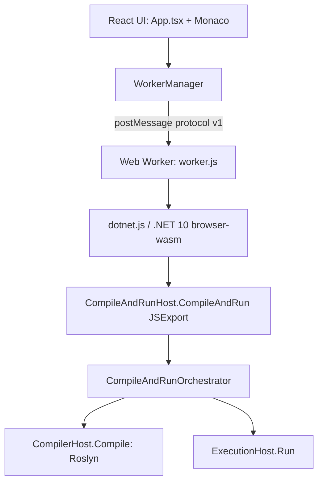
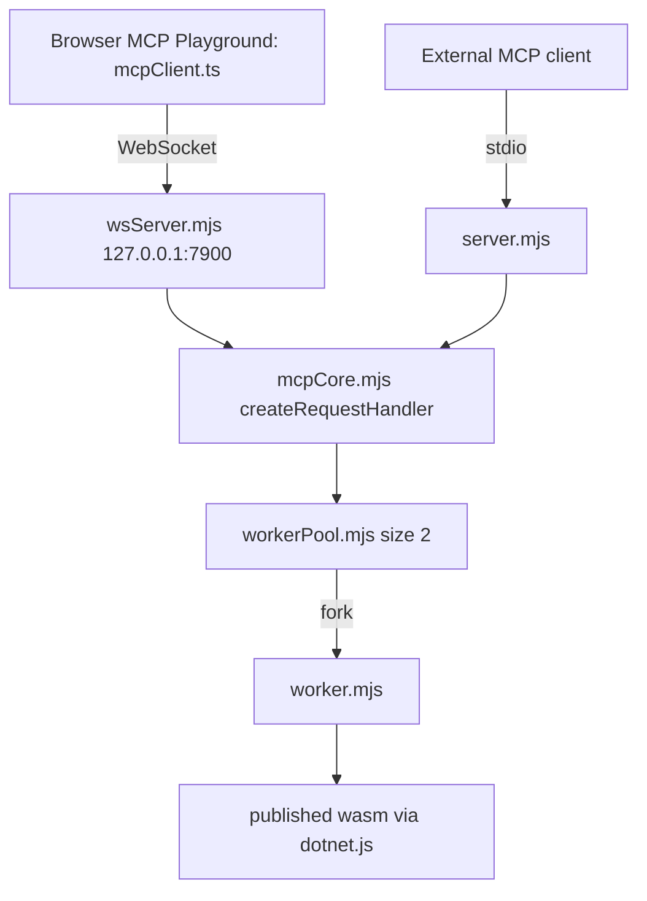
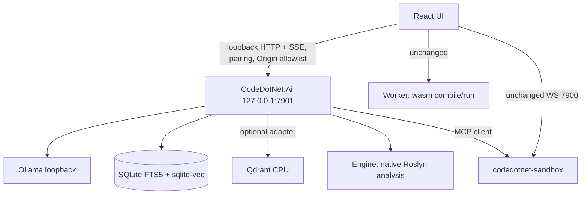

# CodeDotNet: Current Architecture

Everything in sections 1-4 is **[V]** (verified in source). Section 5 is **[P]** (proposed).

## 1. Browser playground

- The worker is dedicated; the UI thread never compiles.
- `WorkerManager` states: Uninitialized, Initializing, Ready, Busy, Stopping, Stopped, Failed, Recovering.
- Default execution timeout is 5,000 ms. On timeout the worker is stopped and re-initialized.
- Requests carry `requestId`; stale responses are discarded.
- `ExecutionStatus` in `protocol.ts` has no `TimedOut`, although the sandbox emits it.

## 2. Compile and execute behavior

- `CompilerHost.Compile(source)`: one syntax tree named `Program.cs`, `LanguageVersion.Latest`, console application, Release, nullable enabled, unsafe disallowed, deterministic, `concurrentBuild: false`. References come from `Basic.Reference.Assemblies.Net100`. Only compiler diagnostics are produced; no semantic-model analysis or analyzers.
- `ExecutionHost.Run`: loads the assembly, invokes the entry point by reflection, merges stdout and stderr into one buffer capped at 100,000 characters, and captures exception type/message/stack and exit code.
- Statuses observed: `BuildFailed`, `ExecutionFailed`, `ExecutionCompleted`, `ExecutionCompletedWithWarnings`.

## 3. MCP sandbox

- Methods: `initialize`, `tools/list`, `tools/call`, `shutdown`; `protocolVersion` `2024-11-05`.
- Tool list is a hard-coded array with one tool, `compile_and_run`.
- Timeout kill is a hard `SIGKILL` and the worker is respawned.

## 4. Build and deployment

- `deploy.yml` validate job: restore/build `codedotnet.compiler`, discovery-based `dotnet test`, `npm ci`, typecheck, lint, format check, `npm test`, build, asset verification.
- Deploy job (main only): publish worker assets with release configuration, base path `/<repo>/`, upload to GitHub Pages.
- Sandbox `node --test` is **not** run in CI.

## 5. Proposed target architecture [P]

Rules:

1. The browser never calls Ollama or Qdrant directly.
2. The sandbox WebSocket service on 7900 is kept; the AI service uses it for execution.
3. Without `CodeDotNet.Ai` running, the playground behaves exactly as today.
4. The AI service needs CSP `connect-src` for `http://127.0.0.1:*` and `http://localhost:*` (currently only `ws://` loopback entries exist).

## 6. Risks [R]

- An HTTPS Pages origin calling an HTTP loopback service depends on browser handling of loopback as potentially trustworthy and on newer local-network-access prompts. Must be tested on target browsers before Phase 1.
- Current sandbox accepts any Origin when `MCP_ALLOWED_ORIGIN` is unset. See [`security-and-privacy-baseline.md`](security-and-privacy-baseline.md).
