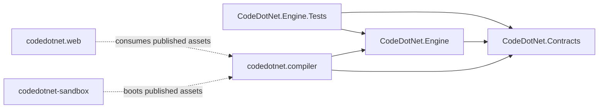

# CodeDotNet: Repository Map

Evidence legend: **[V]** verified on branch `codedotnet-mcp-platform`; **[P]** proposed, does not exist yet; **[G]** generated or ignored build output.

## 1. Top level

```text
codedotnet/
├── codedotnet.slnx                  [V] 4 projects (Contracts, Engine, Engine.Tests, compiler)
├── CodeDotNet.Contracts/            [V] DTOs + source-generated JSON context
├── CodeDotNet.Engine/               [V] CompilerHost, ExecutionHost, CompileAndRunOrchestrator, RuntimeInfo
├── CodeDotNet.Engine.Tests/         [V] xUnit; xunit.runner.json disables parallelism (global Console.SetOut/SetIn)
├── codedotnet.compiler/             [V] browser-wasm [JSExport] adapter + wwwroot/worker.js
├── codedotnet.web/                  [V] React/Vite frontend (not in the .slnx)
│   └── public/dotnet-worker/        [G] published wasm artifact (untracked)
├── codedotnet-sandbox/              [V] Node MCP server (not in the .slnx)
run-worker-script.cjs, validate-worker.cjs
├── docs/                            [V] architecture, security, privacy, testing, ADRs, research
├── .github/                         [V] workflows/deploy.yml, dependabot.yml
├── CodeDotNet.Ai/                   [P] native .NET 10 orchestrator (loopback HTTP+SSE)
├── CodeDotNet.Ai.Abstractions/      [P] provider/store interfaces
├── CodeDotNet.Ai.Tests/             [P] unit and contract tests
├── scripts/dev/                     [P] Start/Stop/Health/Probe/Diagnostics/Prereqs scripts
└── .codedotnet/                     [P] gitignored local run state (run/pids.json, logs)
```

User data is proposed to live outside the repo in `%LOCALAPPDATA%\CodeDotNet\ai\` **[P]**.

## 2. Project dependency graph [V]



Proposed addition **[P]**: `CodeDotNet.Ai` references `CodeDotNet.Engine` and `CodeDotNet.Contracts` for native Roslyn analysis. It must not reference `codedotnet.compiler` (browser-wasm).

## 3. Key source files

| Path | Responsibility |
|---|---|
| `CodeDotNet.Engine/CompilerHost.cs` | Roslyn compile of one syntax tree (`Program.cs`) |
| `CodeDotNet.Engine/ExecutionHost.cs` | Loads and runs the emitted assembly; merged stdout/stderr; 100,000-char output cap |
| `CodeDotNet.Engine/CompileAndRunOrchestrator.cs` | Compile then run; returns `CompileAndRunResponse` |
| `codedotnet.compiler/CompileAndRunHost.cs` | `[JSExport] CompileAndRun(source)` |
| `codedotnet.compiler/wwwroot/worker.js` | Worker: `GetRuntimeInformation` / `CompileAndRun` |
| `codedotnet.web/src/workers/workerManager.ts` | Worker lifecycle, timeout, stop/recover |
| `codedotnet.web/src/workers/protocol.ts` | Typed message protocol (`PROTOCOL_VERSION = 1`) |
| `codedotnet.web/src/mcp/mcpClient.ts` | Browser JSON-RPC over WebSocket |
| `codedotnet-sandbox/src/mcpCore.mjs` | JSON-RPC dispatch; single hard-coded `compile_and_run` tool |
| `codedotnet-sandbox/src/workerPool.mjs` | Forked child pool (default 2), SIGKILL on timeout (default 10 s) |
| `codedotnet-sandbox/src/wsServer.mjs` | WebSocket transport (default `127.0.0.1:7900`) |
| `codedotnet.web/index.html` | CSP meta tag |

## 4. Documentation layout

| Path | Notes |
|---|---|
| `docs/adr/001..008` | Existing ADRs, naming `NNN-name.md` |
| `docs/research/` | Legacy requirements, sandbox SRS, spike findings, and the AI feasibility proposal (untracked at the time of writing) |
| `docs/context/` | This context package (new) |
| `docs/ai/` | AI master plan, validation report, benchmarks and stubs (new) |

## 5. Known path inconsistencies [V]

Several existing docs still reference `codedotnet.compiler.tests` and `codedotnet.compiler/{CompilerHost,ExecutionHost}.cs`. The real locations are `CodeDotNet.Engine.Tests/` and `CodeDotNet.Engine/`. These files are not edited in this PR; see [`documentation-index.md`](documentation-index.md).
