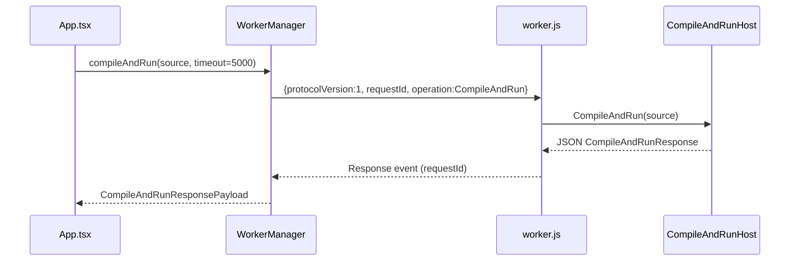
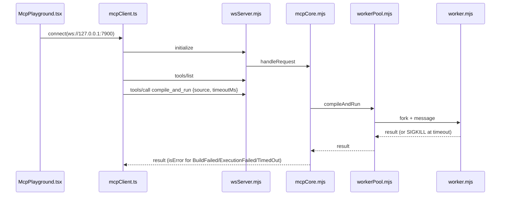

# CodeDotNet: Runtime Flows

Flows 1-8 are **[V]** at file/symbol level as read in source. Flows marked **[P]** are proposed. Details not read line-by-line (for example UI handlers in `App.tsx`) are marked *lower confidence*.

## 1. Edit and settings persistence [V]

- Editor: `codedotnet.web/src/components/MonacoEditor.tsx`; settings in `src/editor/editorSettings.ts`.
- `localStorage` keys: `codedotnet.editor.settings`, `codedotnet.theme`.
- No `fetch`, XHR or `sendBeacon` exists in `src/`; the only network API is `new WebSocket(url)` in `src/mcp/mcpClient.ts`.

## 2. Run (browser) [V]

## 3. Stop and recovery [V]

`WorkerManager.stop()` terminates the worker; `recover()`/`initialize()` create a new one. On timeout the manager calls `stop()` then `initialize()`. Responses with a stale `requestId` are discarded.

## 4. Program input [V]

The application provides no program input. `ExecutionHost` sets console input to an empty reader while the program runs, so `Console.ReadLine()` returns `null`. On browser-wasm, reading `Console.In` can throw `PlatformNotSupportedException`; `ExecutionHost` handles this.

## 5. Output and diagnostics [V]

`CompileAndRunResponse` carries `Output` (stdout+stderr merged, capped at 100,000 characters, `OutputTruncated` flag), `Diagnostics` (`DiagnosticInfo`: Id, Severity, Message, FilePath, StartLine, StartColumn, EndLine, EndColumn), exit code, exception fields and three durations. Internal compiler failures use diagnostic id `CDN000`.

## 6. Complexity estimate [V]

`codedotnet.web/src/complexity.ts` is a TypeScript heuristic, not a Roslyn analysis. A Roslyn-based result would be a new, separately labeled feature **[P]**.

## 7. MCP Playground [V]

Server-side gaps (no timeout cap, no payload cap, no cancellation, permissive Origin when unconfigured) are listed in [`security-and-privacy-baseline.md`](security-and-privacy-baseline.md).

## 8. Build, worker publish and deploy [V]

1. `npm run build:worker` (`codedotnet.web`) runs `scripts/run-worker-script.cjs`.
2. That runs `scripts/copy-worker-assets.ps1`, which executes `dotnet publish` of `codedotnet.compiler` into `codedotnet.web/public/dotnet-worker`.
3. `vite build` produces the static site.
4. `deploy.yml` uploads to GitHub Pages on `main`.

## 9. Proposed AI flows [P]

| Flow | Sketch |
|---|---|
| Health | UI polls `GET /v1/health`; unavailable service means AI UI hidden or disabled, playground unaffected |
| Pairing | User enters a one-time pairing code shown by `Start-CodeDotNet.ps1`; service issues a session token bound to an allowed Origin |
| Ask | `POST` request, SSE token stream, citations validated against retrieved chunk ids |
| Review/debug | Native Roslyn evidence first, then model; patch compile-validated through sandbox MCP |
| Agent | Bounded state machine; iteration/time/tool budgets; stop at any time |
| Start/stop | `scripts/dev/Start-CodeDotNet.ps1`, `Stop-CodeDotNet.ps1` using `.codedotnet/run/pids.json` |

See the master plan for details.
