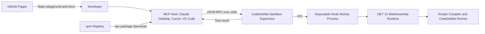
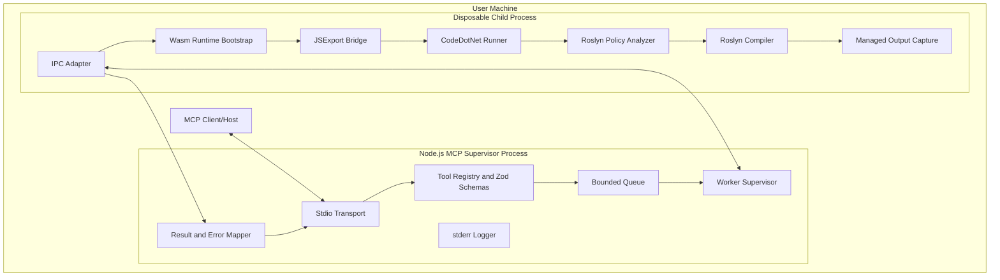
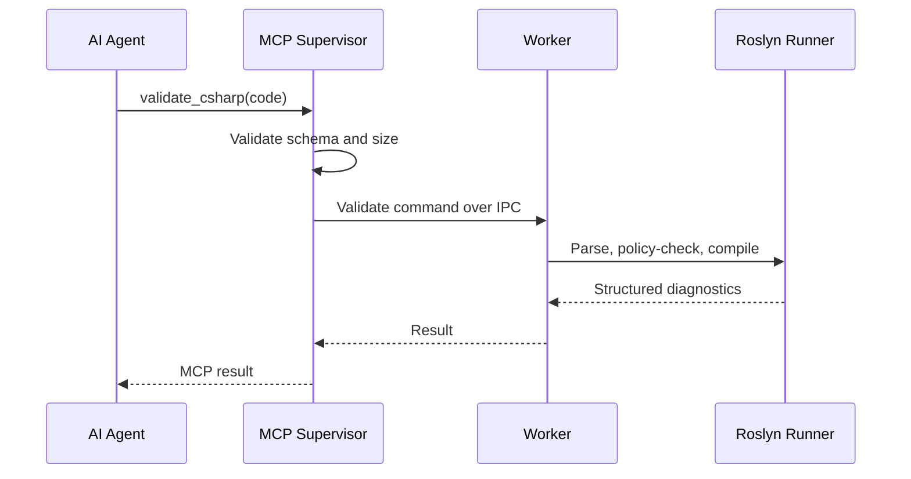
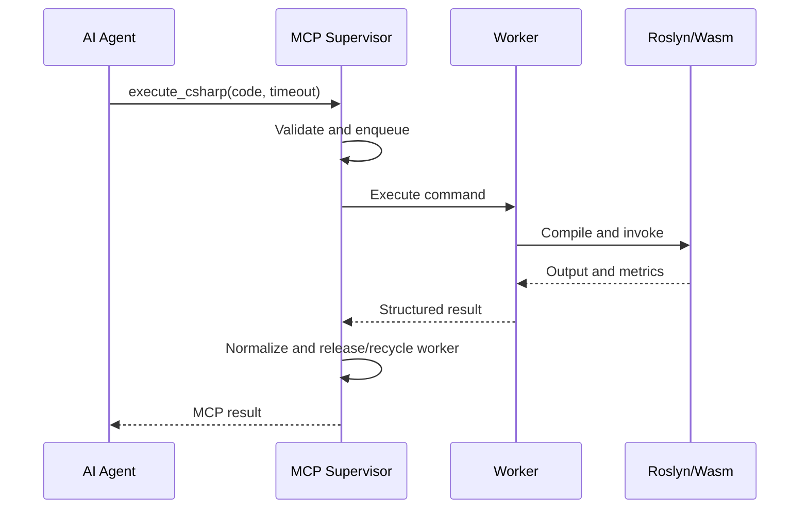
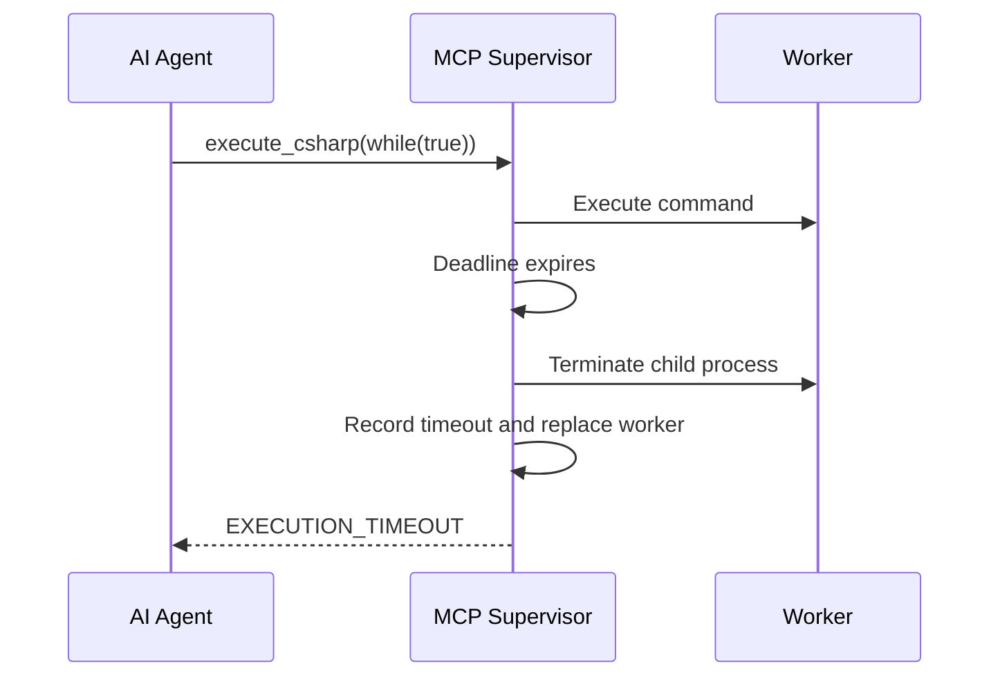

# CodeDotNet Sandbox
## Software Requirements Specification and Architecture Design Document

**Project type:** Zero-cost, local-first MCP server for capability-restricted C# compilation and execution  
**Proposed package:** `@hunk7/codedotnet-sandbox`  
**CLI command:** `codedotnet-sandbox`  
**Existing product:** [CodeDotNet](https://hunk7.github.io/codedotnet/)  
**Document version:** 1.0  
**Status:** Architecture baseline  
**Last updated:** 13 October 2026  
**Primary audience:** Maintainers, contributors, security reviewers, interviewers, and AI-tool integrators

---

## 1. Executive Summary

CodeDotNet Sandbox extends the existing **CodeDotNet** project, a browser-based C# playground powered by .NET 10 WebAssembly and Roslyn, into a local Model Context Protocol (MCP) server that allows AI coding agents to validate, compile, test, and execute C# without requiring Docker, a locally installed .NET SDK, a hosted execution backend, an account, or authentication.

The product is distributed as an npm package and launched by an MCP host using `npx`. A long-lived Node.js supervisor handles MCP JSON-RPC over standard input/output, request validation, scheduling, timeout enforcement, worker lifecycle, result normalization, and diagnostic logging. Untrusted C# executes only inside a disposable child-process worker containing the CodeDotNet .NET WebAssembly runtime and Roslyn compiler.

The architecture is intentionally **local-first and zero-hosting-cost**:

- The existing CodeDotNet browser playground remains hosted as static assets on GitHub Pages.
- Documentation, architecture diagrams, security reports, benchmark reports, and installation instructions can be hosted on GitHub Pages.
- The executable MCP server runs on the user's machine through `npx`; GitHub Pages cannot host a stdio MCP process.
- GitHub Actions builds, tests, benchmarks, signs, and publishes artifacts within applicable free-tier limits.
- npm distributes the Node.js package and bundled WebAssembly assets.
- No user account, server-side identity, authentication flow, database, telemetry backend, or paid hosting service is required.

The project is intended to demonstrate SDE3-level ownership through explicit trust boundaries, fault isolation, backpressure, worker supervision, resource governance, security testing, protocol correctness, measurable performance, supply-chain controls, release automation, and transparent architectural trade-offs.

---

## 2. Document Purpose

This document defines:

1. Product goals and non-goals.
2. Functional and non-functional requirements.
3. System context, containers, components, and data flows.
4. Trust boundaries and threat model.
5. Execution lifecycle and worker supervision.
6. MCP tool contracts and error taxonomy.
7. Folder structure and module responsibilities.
8. Security, reliability, performance, testing, CI/CD, release, and operations plans.
9. Inclusive and exclusive scope for MVP and later releases.
10. Acceptance criteria and implementation roadmap.

This document is both a Software Requirements Specification (SRS) and an Architecture Design Document (ADD). Requirements use stable identifiers so that code, tests, issues, pull requests, and release notes can reference them.

---

## 3. Product Vision

> Enable AI coding agents to safely validate and execute ordinary C# snippets through a fast, local, account-free MCP tool built on the existing CodeDotNet Roslyn and .NET WebAssembly engine.

### 3.1 Value Proposition

- **For C# developers:** verify generated code without installing Docker or running an external cloud sandbox.
- **For AI agents:** receive structured compiler diagnostics, execution output, test results, limits, and termination reasons.
- **For security-conscious users:** keep source code local and expose no intentional host filesystem, network, process, environment-variable, or native-library capability to guest code.
- **For maintainers:** reuse one core CodeDotNet execution engine across the browser playground and MCP integration.
- **For portfolio evaluation:** demonstrate compiler engineering, protocol integration, platform design, security architecture, testing discipline, and production-quality delivery.

### 3.2 Product Principles

1. **Local by default.** Source code is not sent to a CodeDotNet-operated service.
2. **No identity layer.** No login, registration, API key, account, or authentication is required for the local stdio product.
3. **Fail closed.** Unknown profiles, assemblies, capabilities, or invalid policies are rejected.
4. **Supervisor survives guest failure.** Timeout, trap, OOM, and invalid guest output must not terminate or corrupt the MCP supervisor.
5. **One execution per worker.** Avoid global-console races and cross-request contamination.
6. **Measured claims only.** No performance or security claim is published without a repeatable test.
7. **Defense in depth.** Roslyn policy analysis complements, but does not replace, runtime isolation.
8. **Protocol purity.** MCP stdout contains only valid protocol messages; all diagnostics use stderr.
9. **Transparent limitations.** The project does not claim mathematical security, perfect isolation, or Docker-equivalent kernel isolation.
10. **Reusable core.** Browser and MCP adapters consume the same execution contracts where technically feasible.

---

## 4. Goals, Non-Goals, and Constraints

### 4.1 Goals

- Reuse the existing CodeDotNet .NET 10 WebAssembly and Roslyn build output.
- Expose meaningful MCP capabilities, not merely a wrapper around one function.
- Support C# validation, execution, test execution, and capability discovery.
- Demonstrate hard timeout enforcement by terminating disposable workers.
- Bound source size, output size, queue size, execution duration, and worker lifetime.
- Prevent guest output from corrupting or spoofing MCP JSON-RPC messages.
- Provide structured compiler diagnostics and stable machine-readable error codes.
- Support Windows, macOS, and Linux on supported Node.js versions.
- Operate with no paid hosting and no mandatory cloud service.
- Preserve the existing GitHub Pages playground.
- Produce architecture, benchmark, threat-model, and security-test evidence suitable for an SDE3 portfolio.

### 4.2 Non-Goals

- Running arbitrary NuGet packages in the MVP.
- Providing internet access to guest code.
- Providing host filesystem access to guest code.
- Providing process execution, shell commands, native interop, or OS APIs.
- Supporting ASP.NET Core web applications inside the sandbox.
- Supporting multi-project solutions, MSBuild, `.csproj`, or source generators in the MVP.
- Providing a public multi-tenant remote code-execution service.
- Replacing Docker, Firecracker, gVisor, or operating-system isolation for hostile production workloads.
- Guaranteeing deterministic execution for all C# programs.
- Supporting long-running workloads.
- Persisting execution history.
- Collecting analytics or user code.
- Providing account synchronization, collaboration, or shared workspaces.
- Hosting the stdio MCP server directly on GitHub Pages.

### 4.3 Hard Constraints

- No account or authentication for local stdio usage.
- No mandatory .NET installation for end users.
- No Docker requirement.
- Zero mandatory hosting cost.
- Existing CodeDotNet browser experience must continue to work.
- MCP protocol messages must not be mixed with guest or diagnostic output.
- Untrusted code must not execute in the MCP supervisor process.

### 4.4 Assumptions

- The user has a supported Node.js runtime and `npx`.
- The MCP host can launch a local stdio process.
- The npm package can contain the required .NET WebAssembly runtime and managed assemblies.
- Licensing permits redistribution of all bundled runtime and Roslyn assets; this must be verified before public release.
- The CodeDotNet compiler can be refactored to expose stable `[JSExport]` entry points and structured results.

---

## 5. Stakeholders and Personas

### 5.1 Primary Stakeholders

- Project owner and maintainer.
- C# developers using AI coding agents.
- Contributors working on Node.js, TypeScript, C#, Roslyn, and WebAssembly.
- Security reviewers.
- MCP client and host integrators.
- Recruiters and engineering interviewers evaluating architectural depth.

### 5.2 Personas

#### AI-Assisted C# Developer
Wants an agent to compile and test generated C# locally before accepting the answer.

#### MCP Host
Needs discoverable tools, strict schemas, predictable errors, cancellation handling, and protocol-compliant stdio behavior.

#### Security Reviewer
Needs an explicit threat model, denied-capability matrix, adversarial tests, supply-chain controls, and honest residual-risk documentation.

#### Maintainer
Needs reproducible builds, modular components, cross-platform tests, semantic versioning, release automation, and actionable diagnostics.

---

## 6. Scope by Release

### 6.1 MVP, Version 0.1

Included:

- `validate_csharp`
- `execute_csharp`
- `get_sandbox_capabilities`
- MCP stdio transport
- npm package and CLI
- Disposable child-process worker
- Hard timeout by worker termination
- Source and output limits
- One active request per worker
- Strict assembly-reference allowlist
- Structured Roslyn diagnostics
- Cross-platform smoke tests
- Security tests for timeout, OOM, protocol injection, filesystem, network, process, environment, and state leakage
- Existing CodeDotNet GitHub Pages deployment retained
- GitHub Pages documentation site

Excluded:

- `run_csharp_tests`
- Warm worker pool with more than one worker
- External packages
- HTTP transport
- Remote execution service
- Telemetry export

### 6.2 Version 0.2

Included:

- `run_csharp_tests`
- Configurable warm worker pool
- Bounded request queue
- Worker recycling policies
- Structured performance metrics in responses
- Benchmark suite and published reports
- MCP Inspector and host-compatibility tests
- Cancellation propagation from MCP request to worker termination

### 6.3 Version 1.0

Included:

- Stable schemas and documented compatibility policy
- Signed releases and npm provenance
- SBOM and third-party notices
- Windows, macOS, and Linux support matrix
- Soak-test evidence
- Security review checklist
- Versioned architecture decisions
- Incident and vulnerability-reporting process
- Reproducible CodeDotNet runtime asset manifest

### 6.4 Future Options, Not Commitments

- Browser UI that generates MCP configuration snippets.
- Optional Streamable HTTP adapter bound to loopback only.
- WASI or alternate Wasm runtime backend.
- Pluggable `ISandboxExecutor` abstraction.
- Additional language versions and execution profiles.
- Optional in-memory test framework independent of xUnit packages.
- Offline package cache for a very small, curated package allowlist.

---

## 7. Functional Requirements

### 7.1 MCP Server

- **FR-MCP-001:** The system shall expose an MCP server over stdio.
- **FR-MCP-002:** The server shall read protocol messages from stdin and write only valid MCP protocol messages to stdout.
- **FR-MCP-003:** All server diagnostics shall be written to stderr.
- **FR-MCP-004:** The server shall advertise its name, version, supported tools, and tool schemas.
- **FR-MCP-005:** The server shall validate all tool inputs before allocating an execution worker.
- **FR-MCP-006:** The server shall reject unknown fields when strict-schema mode is enabled.
- **FR-MCP-007:** The server shall handle client cancellation and stop the affected execution as soon as practical.
- **FR-MCP-008:** Closing stdin shall initiate graceful supervisor shutdown.
- **FR-MCP-009:** Shutdown shall terminate active and idle workers within a configured grace period.
- **FR-MCP-010:** The CLI shall return a nonzero exit code for unrecoverable startup/configuration failure.

### 7.2 `validate_csharp`

- **FR-VAL-001:** Accept C# source without executing it.
- **FR-VAL-002:** Return parse and compilation diagnostics.
- **FR-VAL-003:** Include diagnostic ID, severity, message, line, column, start/end span, and source file identifier.
- **FR-VAL-004:** Support configured language versions only.
- **FR-VAL-005:** Apply assembly-reference policy and semantic policy checks.
- **FR-VAL-006:** Return `valid`, `invalid`, `rejected`, or `internal_error` status.
- **FR-VAL-007:** Enforce maximum source size before worker allocation.

### 7.3 `execute_csharp`

- **FR-EXE-001:** Accept source, stdin, arguments, profile, and requested timeout.
- **FR-EXE-002:** Clamp timeout to server-defined minimum and maximum values.
- **FR-EXE-003:** Compile source using Roslyn in memory.
- **FR-EXE-004:** Execute only when compilation and policy validation succeed.
- **FR-EXE-005:** Capture stdout and stderr separately inside the worker.
- **FR-EXE-006:** Truncate output at configured byte limits while preserving a truncation indicator.
- **FR-EXE-007:** Return stable status, exit/termination reason, diagnostics, output, elapsed time, and profile.
- **FR-EXE-008:** Terminate the worker when execution exceeds its deadline.
- **FR-EXE-009:** Discard a worker after timeout, trap, OOM, protocol fault, or configured request-count threshold.
- **FR-EXE-010:** Never return raw host paths or secrets in default error responses.
- **FR-EXE-011:** Serialize tool results as data so guest output cannot become a protocol message.

### 7.4 `run_csharp_tests`

- **FR-TST-001:** Accept production source and test definitions/source.
- **FR-TST-002:** Compile production source and tests together under the selected policy profile.
- **FR-TST-003:** Return total, passed, failed, skipped, duration, and per-test failure details.
- **FR-TST-004:** Enforce a total request deadline and optional per-test deadline.
- **FR-TST-005:** Limit test count, test-source size, and failure-output size.
- **FR-TST-006:** Avoid requiring arbitrary external NuGet packages in the first implementation.

### 7.5 `get_sandbox_capabilities`

- **FR-CAP-001:** Return supported tools, profiles, language versions, runtime version, compiler version, limits, and denied capabilities.
- **FR-CAP-002:** Return whether network, host filesystem, process execution, environment access, native interop, unsafe code, reflection emit, and external packages are available.
- **FR-CAP-003:** Return package/server version for troubleshooting.

### 7.6 Configuration

- **FR-CFG-001:** Defaults shall be secure and usable without configuration.
- **FR-CFG-002:** Configuration may be supplied through CLI flags and selected environment variables for the trusted supervisor only.
- **FR-CFG-003:** Guest code shall not receive supervisor environment variables.
- **FR-CFG-004:** Invalid security-sensitive values shall fail startup rather than silently weakening policy.
- **FR-CFG-005:** A `--print-config` mode shall emit effective configuration to stderr or a user-selected file, never mixed into MCP stdout.
- **FR-CFG-006:** A `--self-test` mode shall validate runtime assets and execute a harmless smoke test without starting MCP transport.

---

## 8. Non-Functional Requirements

### 8.1 Security

- **NFR-SEC-001:** Untrusted C# shall execute outside the MCP supervisor process.
- **NFR-SEC-002:** Guest code shall have no intentional host filesystem, network, process, environment-variable, or native-library access.
- **NFR-SEC-003:** The worker shall expose the minimum JS imports required by the runtime and runner.
- **NFR-SEC-004:** Metadata references shall be allowlisted by profile.
- **NFR-SEC-005:** Dangerous APIs shall be blocked by semantic policy where feasible.
- **NFR-SEC-006:** Security policy shall fail closed.
- **NFR-SEC-007:** Guest output shall not write directly to MCP stdout.
- **NFR-SEC-008:** Runtime assets shall be verified against a build-generated SHA-256 manifest.
- **NFR-SEC-009:** Secrets shall not be required for normal execution.
- **NFR-SEC-010:** Dependency and artifact vulnerabilities shall be scanned in CI.

### 8.2 Reliability

- **NFR-REL-001:** The supervisor shall remain responsive after guest timeout, managed exception, Wasm trap, worker crash, and OOM-like failure.
- **NFR-REL-002:** A failed worker shall be removed from service and replaced when capacity permits.
- **NFR-REL-003:** Requests shall have unique internal correlation IDs.
- **NFR-REL-004:** The queue shall be bounded.
- **NFR-REL-005:** Every accepted request shall end in success, rejection, cancellation, timeout, resource termination, worker failure, or internal error.
- **NFR-REL-006:** No request shall remain indefinitely in an unresolved state.

### 8.3 Performance Targets

Targets are provisional until benchmarked:

- **NFR-PERF-001:** Warm validation p95 target: at most 1.5 seconds for source up to 20 KB.
- **NFR-PERF-002:** Warm simple execution p95 target: at most 2 seconds excluding user-configured long execution.
- **NFR-PERF-003:** Timeout termination drift target: at most 500 ms beyond configured deadline.
- **NFR-PERF-004:** Supervisor idle memory and worker memory shall be measured and published, not guessed.
- **NFR-PERF-005:** First-call, warm-call, worker-start, Roslyn-compile, and end-to-end MCP latency shall be measured independently.
- **NFR-PERF-006:** No “sub-50 ms cold start” claim shall be published unless end-to-end data supports the exact defined measurement.

### 8.4 Compatibility

- **NFR-COMP-001:** Test current supported Node.js LTS versions selected at implementation time.
- **NFR-COMP-002:** Test Windows x64, Ubuntu x64, and macOS on available GitHub-hosted runners.
- **NFR-COMP-003:** Document MCP host configuration for Claude Desktop, Cursor, and VS Code-compatible MCP hosts where verified.
- **NFR-COMP-004:** Version-lock .NET runtime assets and Roslyn assemblies to the CodeDotNet build.

### 8.5 Maintainability

- **NFR-MNT-001:** MCP, supervision, worker IPC, Wasm bootstrap, compiler, policy, and contracts shall be independently testable.
- **NFR-MNT-002:** Public result contracts shall be versioned.
- **NFR-MNT-003:** Architecture decisions shall be recorded as ADRs.
- **NFR-MNT-004:** Build outputs shall not be manually edited.
- **NFR-MNT-005:** Browser and MCP execution behavior shall share tests for compiler diagnostics and policy where possible.

### 8.6 Privacy

- **NFR-PRV-001:** User source and output shall remain local by default.
- **NFR-PRV-002:** No analytics, crash upload, or remote logging shall be enabled by default.
- **NFR-PRV-003:** Documentation shall describe npm installation/network behavior separately from code execution behavior.
- **NFR-PRV-004:** Logs shall not contain full source unless explicit debug mode is enabled by the user.

### 8.7 Cost

- **NFR-COST-001:** The project shall require no paid runtime hosting.
- **NFR-COST-002:** GitHub Pages shall host static documentation and the existing playground only.
- **NFR-COST-003:** npm shall distribute the executable package.
- **NFR-COST-004:** Optional services that can incur cost shall not be required for core functionality.

---

## 9. System Context



### 9.1 Runtime Boundaries

- GitHub Pages serves static browser assets and documentation.
- The MCP host launches the npm CLI locally.
- The supervisor is trusted orchestration code.
- The worker is disposable infrastructure and is not trusted to remain healthy after a guest failure.
- The Wasm runtime and CodeDotNet runner form the immediate managed execution environment.
- Generated C# source, arguments, stdin, and generated tests are untrusted.

---

## 10. Container Architecture



### 10.1 Why a Child Process Is Required

A JavaScript `Promise.race()` does not preempt synchronous CPU-bound managed/Wasm execution on the same event loop. The hard timeout boundary is therefore process termination. A child process also provides complete reclamation of Wasm linear memory, managed heap, loaded assemblies, static state, callbacks, and output buffers after timeout or failure.

### 10.2 Worker Modes

#### Strict Mode

- One new worker per execution.
- Strongest request isolation available in this design.
- Highest startup cost.
- Recommended for untrusted or security-demonstration workloads.

#### Pooled Mode

- Small number of pre-warmed child processes.
- One active request per worker.
- Worker recycled after request count, memory threshold, timeout, trap, OOM, or protocol violation.
- Default candidate after soak testing.

---

## 11. Component Design

### 11.1 MCP Transport Adapter

Responsibilities:

- Initialize the MCP SDK server.
- Register tools.
- Receive and validate requests.
- Correlate cancellation.
- Write only SDK-generated MCP messages to stdout.
- Route diagnostic messages to stderr.

Must not:

- Execute guest code.
- Import or initialize the Wasm runtime.
- Write guest output directly.
- retain full source after request completion.

### 11.2 Tool Layer

Responsibilities:

- Define strict schemas with Zod.
- Apply source-size and parameter limits.
- Translate MCP input into internal commands.
- Convert internal result contracts into MCP content blocks.
- Keep tool descriptions clear enough for autonomous agents.

### 11.3 Execution Supervisor

Responsibilities:

- Generate request IDs.
- Apply queue and concurrency limits.
- Start, monitor, and terminate child workers.
- Enforce hard deadlines.
- Handle worker exit, IPC corruption, heartbeat failure, and cancellation.
- Normalize failure modes.
- Guarantee single completion of each request.

### 11.4 Worker Protocol

Messages from parent to worker:

- `initialize`
- `validate`
- `execute`
- `runTests`
- `cancel`
- `shutdown`
- `ping`

Messages from worker to parent:

- `ready`
- `result`
- `failure`
- `metrics`
- `pong`
- `log`

Each message includes:

- Protocol version.
- Request ID where applicable.
- Message type.
- Timestamp.
- Payload validated on both sides.

Malformed or unexpected worker messages cause worker termination.

### 11.5 Wasm Runtime Manager

Responsibilities:

- Resolve package-relative runtime assets without depending on current working directory.
- Verify asset hashes in strict mode.
- Load `dotnet.js` once per worker.
- Initialize the correct managed assembly.
- Resolve `[JSExport]` functions.
- Expose typed `validate`, `execute`, and test methods.
- Normalize JS/Wasm exceptions.

Must not:

- Override global console functions in the MCP supervisor.
- expose Node.js filesystem/network/process functions to guest C#.
- reuse a worker after fatal runtime failure.

### 11.6 CodeDotNet Runner

Responsibilities:

- Parse source.
- Run policy analysis.
- Resolve only profile-approved references.
- Compile to an in-memory assembly.
- Capture structured diagnostics.
- Load and invoke the supported entry point.
- Capture managed stdout/stderr.
- Return a serialized result contract.
- Restore global managed console state in `finally`.

Constraints:

- One execution at a time per worker.
- No background tasks allowed to outlive request completion.
- No analyzer or source-generator loading from user input.
- No dynamic external assembly resolution.

### 11.7 Policy Engine

Two layers:

1. **Reference policy:** grants only explicit framework assemblies.
2. **Semantic policy:** detects prohibited APIs and constructs.

Policy profiles:

- `strict`: smallest API surface.
- `algorithm`: collections, LINQ, text, numerics, console.
- `unit-test`: algorithm profile plus internal test harness APIs.

Policy checks may reject:

- `DllImport` and `LibraryImport`.
- `JSImport` and `JSExport` in guest source.
- `System.Diagnostics.Process`.
- host filesystem APIs.
- network APIs.
- native-library loading.
- reflection emit.
- unsafe code.
- thread creation.
- excessive `stackalloc` where detectable.
- dynamic assembly loading APIs.

Semantic policy is defense in depth. Runtime capabilities remain the security boundary.

### 11.8 Output Capture

- Capture `Console.Out` and `Console.Error` inside the managed worker.
- Use bounded writers that count UTF-8 bytes.
- Mark `stdoutTruncated` and `stderrTruncated` independently.
- Restore original writers in `finally`.
- Do not globally hijack `console.log` in the parent.
- Convert guest output to an ordinary string field in the tool result.

---

## 12. End-to-End Sequences

### 12.1 Validation



### 12.2 Successful Execution



### 12.3 Timeout



### 12.4 OOM or Trap

1. Worker reports a recognized managed OOM or Wasm/JS failure, or exits unexpectedly.
2. Supervisor marks request `MEMORY_LIMIT_EXCEEDED` or `WORKER_CRASHED` when classification is reliable.
3. Supervisor discards the worker.
4. Queue capacity is restored only after replacement worker readiness.
5. Next request uses a clean worker.

---

## 13. MCP Tool Contracts

### 13.1 `validate_csharp`

Input:

```json
{
  "code": "Console.WriteLine(\"Hello\");",
  "languageVersion": "preview",
  "profile": "algorithm"
}
```

Output:

```json
{
  "status": "valid",
  "diagnostics": [],
  "policyViolations": [],
  "metrics": {
    "elapsedMs": 72,
    "sourceBytes": 33
  },
  "runtime": {
    "dotnet": "10.0",
    "profile": "algorithm"
  }
}
```

### 13.2 `execute_csharp`

Input:

```json
{
  "code": "Console.WriteLine(Enumerable.Range(1, 10).Sum());",
  "languageVersion": "preview",
  "profile": "algorithm",
  "timeoutMs": 3000,
  "stdin": "",
  "arguments": []
}
```

Output:

```json
{
  "status": "completed",
  "exitCode": 0,
  "stdout": "55\n",
  "stderr": "",
  "stdoutTruncated": false,
  "stderrTruncated": false,
  "diagnostics": [],
  "policyViolations": [],
  "metrics": {
    "queueMs": 2,
    "compileMs": 48,
    "executeMs": 4,
    "totalMs": 61
  },
  "sandbox": {
    "profile": "algorithm",
    "network": false,
    "hostFileSystem": false,
    "processExecution": false,
    "environmentVariables": false,
    "externalPackages": false
  }
}
```

### 13.3 Error Result

```json
{
  "status": "terminated",
  "error": {
    "code": "EXECUTION_TIMEOUT",
    "message": "Execution exceeded the configured 3000 ms deadline.",
    "retryable": false
  },
  "stdout": "",
  "stderr": "",
  "metrics": {
    "totalMs": 3312
  }
}
```

### 13.4 Capability Result

```json
{
  "serverVersion": "0.1.0",
  "runtime": ".NET 10 WebAssembly",
  "tools": [
    "validate_csharp",
    "execute_csharp",
    "get_sandbox_capabilities"
  ],
  "profiles": ["strict", "algorithm"],
  "limits": {
    "maxSourceBytes": 102400,
    "maxOutputBytesPerStream": 65536,
    "defaultTimeoutMs": 3000,
    "maxTimeoutMs": 10000,
    "queueCapacity": 20
  }
}
```

---

## 14. Error Taxonomy

### Request and Policy Errors

- `INVALID_ARGUMENT`
- `SOURCE_TOO_LARGE`
- `UNSUPPORTED_LANGUAGE_VERSION`
- `UNKNOWN_PROFILE`
- `POLICY_VIOLATION`
- `UNSUPPORTED_CAPABILITY`
- `QUEUE_FULL`
- `QUEUE_TIMEOUT`

### Compilation Errors

- `COMPILATION_FAILED`
- `COMPILATION_TIMEOUT`
- `REFERENCE_RESOLUTION_FAILED`

### Execution Errors

- `EXECUTION_TIMEOUT`
- `EXECUTION_CANCELLED`
- `MEMORY_LIMIT_EXCEEDED`
- `OUTPUT_LIMIT_EXCEEDED`
- `UNHANDLED_GUEST_EXCEPTION`
- `UNSUPPORTED_ENTRY_POINT`
- `WASM_TRAP`

### Infrastructure Errors

- `WORKER_START_FAILED`
- `WORKER_CRASHED`
- `WORKER_PROTOCOL_ERROR`
- `RUNTIME_ASSET_MISSING`
- `RUNTIME_ASSET_INTEGRITY_FAILED`
- `RUNTIME_INITIALIZATION_FAILED`
- `INTERNAL_ERROR`

Each error contains:

- Stable code.
- Safe human-readable message.
- Retryable flag.
- Optional sanitized details.
- Correlation ID in debug mode.

---

## 15. Security Architecture and Threat Model

### 15.1 Trust Zones

#### Trusted

- MCP supervisor source and dependencies.
- Worker bootstrap.
- Bundled `dotnet.js` and Wasm artifact.
- .NET runtime assemblies.
- Roslyn assemblies.
- CodeDotNet runner and policy code.
- Build and release pipeline after verification.

#### Untrusted

- C# source.
- stdin and command arguments.
- generated test source.
- MCP tool arguments.
- guest output.
- exception messages originating in guest code.
- package installation source until registry and integrity checks succeed.

### 15.2 Protected Assets

- Host filesystem.
- Host environment variables and secrets.
- Host network identity and credentials.
- Parent process availability.
- MCP protocol integrity.
- Other requests' source and output.
- Runtime artifact integrity.
- User privacy.

### 15.3 Threats and Required Controls

#### Infinite Loop / CPU Exhaustion

Controls:

- Execute in child process.
- Parent-side deadline.
- Kill timed-out worker.
- Queue and concurrency limits.
- Recycle worker after termination.

#### Memory Exhaustion

Controls:

- Child-process boundary.
- Wasm memory maximum where supported.
- Node child memory flags where applicable.
- Worker RSS monitoring where portable.
- Worker discard after OOM-like failure.
- Source and output bounds.

#### Output Flooding

Controls:

- Bounded managed writers.
- Byte-based limit.
- Truncation flags.
- No direct guest access to parent stdout.

#### MCP Protocol Injection

Controls:

- Worker IPC separated from MCP stdout.
- Guest output encoded inside SDK tool result.
- Parent stdout owned exclusively by MCP transport.
- Tests using forged JSON-RPC text.

#### Host Filesystem Read/Write

Controls:

- Do not expose host filesystem bridges.
- Exclude filesystem references where feasible.
- Semantic policy rejection.
- Runtime adversarial tests.
- Document any in-memory or virtual filesystem behavior.

#### Network Access and SSRF

Controls:

- Do not expose fetch, sockets, or HTTP bridge to guest code.
- Exclude networking references.
- Semantic policy rejection.
- Test public URL, localhost, DNS, and cloud metadata addresses.

#### Process and Shell Execution

Controls:

- Exclude process APIs.
- Reject semantic references.
- No shell bridge.
- Test Windows and POSIX process-launch attempts.

#### Environment and Secret Access

Controls:

- Do not expose supervisor environment to guest APIs.
- Start child with minimized environment where possible.
- Sanitize errors and paths.
- Avoid logging source or environment by default.

#### Native Interop

Controls:

- Reject P/Invoke, native-library loading, and unsafe code.
- Do not provide native host imports.
- Test `DllImport`, `LibraryImport`, and `NativeLibrary.Load`.

#### Cross-Request State Leakage

Controls:

- Strict mode uses one worker per request.
- Pooled mode uses request-count and failure recycling.
- One request per worker.
- Restore console/culture state.
- Tests for static fields, callbacks, culture, and loaded assemblies.

#### Assembly Accumulation

Controls:

- Measure memory across unique assemblies.
- Recycle after configured request count.
- Strict mode for strongest cleanup.
- Publish soak-test graphs.

#### Supply-Chain Compromise

Controls:

- Pin npm dependencies through lockfile.
- Generate SBOM.
- Verify runtime manifest hashes.
- Use GitHub dependency review and CodeQL where applicable.
- Publish npm provenance.
- Protect release environments.
- Maintain third-party notices.

#### Malformed or Oversized Input

Controls:

- Schema validation.
- Source byte limit before worker allocation.
- Array count and string limits.
- Reject invalid UTF-8/JSON through transport layer.
- Fuzz schemas and worker protocol.

### 15.4 Residual Risks

- Vulnerabilities in Node.js, V8, WebAssembly runtime, .NET runtime, Roslyn, or bundled dependencies.
- Logic errors in host imports or policy implementation.
- Side channels such as timing and resource contention.
- Platform-specific child-process termination behavior.
- Availability impact before the OS reclaims a failed worker.
- APIs reachable transitively through permitted assemblies.
- Incomplete equivalence between browser and Node.js hosting environments.

### 15.5 Security Claims Policy

Allowed wording:

> Guest C# runs in a capability-restricted .NET WebAssembly environment inside a disposable child process. The project does not intentionally expose host filesystem, network, process, environment-variable, or native-library capabilities.

Disallowed wording unless formally proven:

- “Mathematically secure.”
- “Impossible to escape.”
- “Completely zero trust.”
- “OOM cannot affect the host.”
- “Promise timeout stops infinite loops.”
- “Equivalent to kernel or VM isolation.”

---

## 16. Resource Governance

Initial defaults to validate through benchmarks:

- Maximum source: 100 KiB.
- Maximum stdin: 64 KiB.
- Maximum arguments: 32.
- Maximum argument length: 4 KiB.
- Maximum stdout: 64 KiB.
- Maximum stderr: 64 KiB.
- Default execution timeout: 3 seconds.
- Maximum execution timeout: 10 seconds.
- Compilation timeout: 5 seconds.
- Queue capacity: 20 requests.
- Default workers: 1.
- Maximum workers: 4.
- Maximum active request per worker: 1.
- Pooled worker recycle: 25 successful executions or earlier on threshold/failure.
- Shutdown grace period: 2 seconds before forced termination.

Configuration limits must be capped even when overridden, unless a clearly documented unsafe/development mode is selected.

### 16.1 Backpressure

1. Validate cheap limits before enqueueing.
2. Reject immediately when queue is full.
3. Expire requests that exceed queue wait time.
4. Do not spawn unbounded workers.
5. Report `QUEUE_FULL` or `QUEUE_TIMEOUT` as structured results.

### 16.2 Cancellation

- Map MCP cancellation to request ID.
- Remove queued requests without starting a worker.
- For active requests, terminate the dedicated child worker.
- Do not reuse a cancelled worker unless cancellation occurred before guest execution and safe reuse is proven.

---

## 17. Data Design

The core product has no database and no persistent execution history.

### 17.1 In-Memory Data

- Effective configuration.
- Worker state.
- Bounded request queue.
- Request correlation metadata.
- Current runtime versions.
- Aggregate process-local counters when enabled.

### 17.2 Data Retention

- Source is retained only for the lifetime of the request.
- Output is retained only until the response is written.
- Logs exclude source by default.
- No telemetry is transmitted.
- Debug logs are opt-in and warn before including source.

### 17.3 Result Contract Versioning

- Additive fields may be introduced in minor versions.
- Removing or changing field meaning requires a major version.
- Error codes remain stable after 1.0.
- Worker IPC can evolve independently but must include a protocol version.

---

## 18. Complete Repository Structure

```text
codedotnet-mcp/
├── .config/
│   └── dotnet-tools.json
├── .github/
│   ├── ISSUE_TEMPLATE/
│   │   ├── bug-report.yml
│   │   ├── feature-request.yml
│   │   └── security-question.yml
│   ├── workflows/
│   │   ├── ci.yml
│   │   ├── codeql.yml
│   │   ├── dependency-review.yml
│   │   ├── nightly-security.yml
│   │   ├── pages.yml
│   │   ├── publish-npm.yml
│   │   └── release.yml
│   ├── dependabot.yml
│   ├── pull_request_template.md
│   └── CODEOWNERS
├── benchmarks/
│   ├── fixtures/
│   ├── reports/
│   ├── cold-start.ts
│   ├── execution-latency.ts
│   ├── memory-soak.ts
│   └── worker-recycle.ts
├── docs/
│   ├── adr/
│   │   ├── 0001-node-supervisor.md
│   │   ├── 0002-stdio-transport.md
│   │   ├── 0003-child-process-isolation.md
│   │   ├── 0004-reference-allowlist.md
│   │   └── 0005-zero-hosting-cost.md
│   ├── architecture/
│   │   ├── context.md
│   │   ├── containers.md
│   │   ├── components.md
│   │   ├── sequences.md
│   │   └── deployment.md
│   ├── guides/
│   │   ├── claude-desktop.md
│   │   ├── cursor.md
│   │   ├── vscode.md
│   │   ├── troubleshooting.md
│   │   └── development.md
│   ├── security/
│   │   ├── threat-model.md
│   │   ├── security-boundary.md
│   │   ├── denied-capabilities.md
│   │   └── responsible-disclosure.md
│   ├── api/
│   │   ├── tools.md
│   │   ├── result-contracts.md
│   │   └── error-codes.md
│   └── index.md
├── runtime/
│   ├── manifest.json
│   ├── dotnet.js
│   ├── dotnet.native.wasm
│   ├── dotnet.runtime.js
│   ├── dotnet.boot.js
│   └── managed/
│       ├── CodeDotNet.Runner.wasm
│       ├── CodeDotNet.Runner.dll
│       ├── Microsoft.CodeAnalysis.dll
│       ├── Microsoft.CodeAnalysis.CSharp.dll
│       └── approved-runtime-assemblies...
├── scripts/
│   ├── build-runtime.mjs
│   ├── copy-codedotnet-assets.mjs
│   ├── generate-manifest.mjs
│   ├── verify-manifest.mjs
│   ├── package-size-check.mjs
│   └── smoke-test-package.mjs
├── src/
│   ├── cli/
│   │   ├── args.ts
│   │   ├── config.ts
│   │   ├── selfTest.ts
│   │   └── version.ts
│   ├── server/
│   │   ├── createServer.ts
│   │   ├── registerTools.ts
│   │   ├── schemas.ts
│   │   ├── toolDescriptions.ts
│   │   └── resultMapper.ts
│   ├── supervisor/
│   │   ├── ExecutionSupervisor.ts
│   │   ├── WorkerPool.ts
│   │   ├── WorkerHandle.ts
│   │   ├── ExecutionQueue.ts
│   │   ├── TimeoutPolicy.ts
│   │   ├── CancellationRegistry.ts
│   │   └── ResourcePolicy.ts
│   ├── worker/
│   │   ├── workerMain.ts
│   │   ├── WasmRuntimeManager.ts
│   │   ├── RuntimeAssetResolver.ts
│   │   ├── RuntimeIntegrityVerifier.ts
│   │   ├── workerProtocol.ts
│   │   └── workerSchemas.ts
│   ├── contracts/
│   │   ├── commands.ts
│   │   ├── diagnostics.ts
│   │   ├── errors.ts
│   │   ├── results.ts
│   │   └── capabilities.ts
│   ├── logging/
│   │   ├── stderrLogger.ts
│   │   ├── redaction.ts
│   │   └── logLevels.ts
│   ├── metrics/
│   │   ├── timers.ts
│   │   └── processMetrics.ts
│   └── index.ts
├── codedotnet/
│   ├── CodeDotNet.Runner/
│   │   ├── Compilation/
│   │   │   ├── CSharpCompiler.cs
│   │   │   ├── CompilationRequest.cs
│   │   │   ├── MetadataReferenceProvider.cs
│   │   │   └── DiagnosticMapper.cs
│   │   ├── Execution/
│   │   │   ├── AssemblyExecutor.cs
│   │   │   ├── EntryPointResolver.cs
│   │   │   ├── BoundedTextWriter.cs
│   │   │   └── ExecutionResult.cs
│   │   ├── Policy/
│   │   │   ├── ExecutionProfile.cs
│   │   │   ├── ReferencePolicy.cs
│   │   │   ├── SemanticPolicyAnalyzer.cs
│   │   │   └── PolicyViolation.cs
│   │   ├── Interop/
│   │   │   ├── SandboxExports.cs
│   │   │   └── SerializationContext.cs
│   │   └── CodeDotNet.Runner.csproj
│   └── CodeDotNet.Runner.Tests/
├── tests/
│   ├── unit/
│   │   ├── schemas.test.ts
│   │   ├── queue.test.ts
│   │   ├── timeout-policy.test.ts
│   │   └── result-mapper.test.ts
│   ├── integration/
│   │   ├── runtime-init.test.ts
│   │   ├── validate.test.ts
│   │   ├── execute.test.ts
│   │   └── recycle.test.ts
│   ├── mcp/
│   │   ├── stdio-conformance.test.ts
│   │   ├── protocol-isolation.test.ts
│   │   ├── cancellation.test.ts
│   │   └── host-smoke.test.ts
│   ├── security/
│   │   ├── infinite-loop.test.ts
│   │   ├── memory-exhaustion.test.ts
│   │   ├── output-flood.test.ts
│   │   ├── protocol-injection.test.ts
│   │   ├── filesystem-denial.test.ts
│   │   ├── network-denial.test.ts
│   │   ├── process-denial.test.ts
│   │   ├── environment-denial.test.ts
│   │   ├── native-interop-denial.test.ts
│   │   └── state-isolation.test.ts
│   ├── soak/
│   │   ├── unique-assemblies.test.ts
│   │   ├── thousand-executions.test.ts
│   │   └── repeated-failures.test.ts
│   └── fixtures/
├── website/
│   ├── architecture.md
│   ├── benchmarks.md
│   ├── security.md
│   └── index.md
├── .editorconfig
├── .gitignore
├── .npmignore
├── .nvmrc
├── CHANGELOG.md
├── CODE_OF_CONDUCT.md
├── CONTRIBUTING.md
├── LICENSE
├── NOTICE.md
├── README.md
├── SECURITY.md
├── package-lock.json
├── package.json
├── tsconfig.json
└── vitest.config.ts
```

### 18.1 Integration with the Existing CodeDotNet Repository

Preferred strategy:

- Keep CodeDotNet as the source of truth for browser playground and core runner.
- Extract reusable compilation, policy, and execution code into `CodeDotNet.Runner`.
- Build a Node-targeted WebAssembly artifact in CI.
- Copy only generated runtime assets into the MCP package through a deterministic script.
- Generate an asset manifest with version, source commit, file size, and SHA-256.
- Never manually copy or edit runtime binaries.

Repository options:

1. **Monorepo:** best for synchronized contracts and shared tests.
2. **Separate repos with pinned release artifact:** cleaner product separation, more release coordination.
3. **Git submodule:** not recommended as the default developer experience due to clone/update friction.

Recommended initial choice: a monorepo if CodeDotNet can be reorganized safely; otherwise use a separate MCP repository that downloads or copies a versioned CodeDotNet runtime artifact during release builds.

---

## 19. Build and Packaging Design

### 19.1 Build Pipeline

1. Restore pinned .NET and npm dependencies.
2. Build and test CodeDotNet runner.
3. Publish Node-compatible .NET WebAssembly assets.
4. Copy required artifacts into `runtime/`.
5. Generate and verify SHA-256 manifest.
6. Compile TypeScript to ESM JavaScript.
7. Run unit, integration, MCP, and security tests.
8. Pack npm tarball.
9. Install tarball into an isolated temporary directory.
10. Run CLI self-test and MCP smoke test from the packed artifact.
11. Check unpacked package size.
12. Publish only from protected release workflow.

### 19.2 `package.json` Requirements

- `type: module`.
- `bin` mapping for `codedotnet-sandbox`.
- `files` allowlist containing `dist`, `runtime`, licenses, README, and notices.
- supported `engines.node` range.
- `prepack` or `prepublishOnly` validation.
- no lifecycle script that downloads executable code at user install time.
- exact or safely bounded dependency versions through lockfile.

### 19.3 Runtime Asset Resolution

Assets must be resolved relative to the installed module URL, not:

- current working directory,
- user home directory,
- repository root assumptions,
- globally installed npm prefix.

### 19.4 CLI Modes

```text
codedotnet-sandbox                 Start MCP stdio server
codedotnet-sandbox --version       Print version and exit
codedotnet-sandbox --self-test     Verify assets and execute smoke test
codedotnet-sandbox --print-config  Print effective configuration
codedotnet-sandbox --help          Print CLI help
```

Normal MCP mode must print no banners to stdout.

---

## 20. GitHub Pages and Zero-Cost Deployment

### 20.1 What GitHub Pages Can Host

- Existing CodeDotNet browser playground.
- Product landing page.
- Documentation.
- Architecture diagrams.
- Benchmark reports.
- Security model and denied-capability matrix.
- Installation instructions.
- MCP configuration generator that runs entirely in browser.
- Download links to GitHub releases or npm package page.

### 20.2 What GitHub Pages Cannot Host

- A persistent stdio process.
- A Node.js MCP server.
- Child processes.
- Server-side Roslyn execution.
- A multi-tenant remote sandbox.
- Runtime authentication or a private API.

### 20.3 Zero-Cost Product Topology

```text
GitHub Pages       Static playground, docs, diagrams, reports
GitHub repository  Source, issues, discussions, releases
GitHub Actions     Build, test, security scans, Pages deploy
npm registry       Package distribution
User machine       MCP supervisor and all C# execution
```

### 20.4 Account and Authentication Decision

For stdio local mode:

- No account.
- No API key.
- No OAuth.
- No cookies.
- No server session.
- No persistent identity.

If a remote HTTP mode is ever added, it is a separate product scope and requires authentication, authorization, tenant isolation, abuse protection, quotas, privacy policy, and hosting budget. It is explicitly excluded from the local-first 1.0 architecture.

---

## 21. Observability

No remote telemetry is required.

### 21.1 Local Structured Logs

Log to stderr:

- startup and shutdown,
- effective non-secret configuration,
- worker start/ready/exit,
- request state transitions without source,
- timeout and termination reason,
- runtime initialization failure,
- asset verification failure.

Never log by default:

- complete source,
- complete stdin,
- environment variables,
- user paths unless sanitized,
- host secrets,
- full guest exception internals containing paths.

### 21.2 Metrics

Per request:

- queue duration,
- worker acquisition duration,
- compile duration,
- execution duration,
- total duration,
- source bytes,
- output bytes,
- termination reason.

Process-level debug metrics:

- active workers,
- queue depth,
- worker starts and recycles,
- worker failures,
- supervisor memory,
- worker RSS where available.

---

## 22. Testing Strategy

### 22.1 Unit Tests

- Zod schemas.
- configuration parsing and clamping.
- queue and scheduling.
- timeout policy.
- cancellation registry.
- result/error mapping.
- redaction.
- worker protocol validation.
- reference-profile composition.
- Roslyn diagnostic mapping.

### 22.2 Integration Tests

- Load bundled .NET runtime.
- Resolve `[JSExport]` methods.
- Compile valid and invalid source.
- Execute simple console application.
- capture stdout and stderr.
- invoke async entry point if supported.
- handle guest exception.
- recycle worker and execute again.
- run from directory unrelated to package root.

### 22.3 MCP Conformance Tests

- Tool discovery.
- Tool invocation.
- Invalid arguments.
- cancellation.
- shutdown on EOF.
- no non-protocol stdout.
- forged guest JSON-RPC remains result data.
- concurrent client requests are queued safely.

### 22.4 Security Tests

Required hostile cases:

```csharp
while (true) { }
```

```csharp
var list = new List<byte[]>();
while (true) list.Add(new byte[10_000_000]);
```

```csharp
while (true) Console.WriteLine(new string('x', 4096));
```

Also test:

- deep recursion,
- huge source,
- thousands of diagnostics,
- pathological generic nesting,
- `File.ReadAllText`,
- directory enumeration,
- `HttpClient`, sockets, DNS, localhost, and metadata IP,
- `Process.Start`,
- environment access,
- P/Invoke and native loading,
- dynamic assembly load,
- reflection emit,
- background tasks,
- static state leakage,
- culture and console state leakage,
- malformed worker IPC,
- protocol injection,
- repeated worker crashes.

### 22.5 Soak Tests

- 1,000 sequential simple executions.
- 1,000 unique assemblies.
- repeated compilation failures.
- repeated timeouts.
- repeated OOM attempts.
- queue saturation.
- worker recycling under mixed workload.
- supervisor memory trend.
- shutdown during active execution.

### 22.6 Cross-Platform Matrix

- Windows x64.
- Ubuntu x64.
- macOS available GitHub runner architecture.
- Supported Node.js versions.
- Package installed through local npm tarball.

### 22.7 Acceptance Security Matrix

| Attack | Expected outcome |
|---|---|
| Infinite loop | Worker terminated; supervisor serves next request |
| Allocation flood | Worker fails/terminates; supervisor survives |
| Output flood | Output truncated; protocol remains valid |
| Filesystem access | Compilation/policy/runtime denial |
| Network access | Compilation/policy/runtime denial |
| Process start | Compilation/policy/runtime denial |
| Environment access | Denied or empty, with no host secrets exposed |
| Native interop | Rejected or unavailable |
| Protocol injection | Returned only as escaped tool output |
| Cross-request static state | Not visible after worker isolation/recycle |
| Malformed IPC | Worker terminated and result normalized |

---

## 23. Benchmark Plan

Measure separately:

- npm CLI startup.
- supervisor initialization.
- worker process creation.
- .NET Wasm initialization.
- first Roslyn compilation.
- warm Roslyn compilation.
- simple execution.
- worker replacement.
- complete MCP call.
- timeout termination drift.
- memory after 1, 10, 100, and 1,000 executions.

Report:

- machine specification,
- OS and architecture,
- Node.js version,
- .NET/runtime version,
- package version and commit,
- workload source size,
- sample count,
- p50, p95, and p99,
- peak and steady-state memory,
- strict versus pooled worker mode.

Do not compare against Docker, E2B, Modal, or another sandbox unless test conditions, security boundaries, warm/cold state, and pricing assumptions are equivalent and documented.

---

## 24. CI/CD and Release Engineering

### 24.1 Pull Request CI

- format and lint.
- TypeScript type-check.
- .NET build and test.
- unit and integration tests.
- selected security tests.
- npm package build.
- packed-artifact smoke test.
- dependency review.
- runtime-manifest verification.
- package-size threshold.

### 24.2 Nightly CI

- full hostile security suite.
- soak tests.
- memory trend tests.
- benchmark smoke suite.
- cross-platform matrix.
- dependency scanning.

### 24.3 Release Workflow

1. Update changelog and version.
2. Create signed/versioned tag.
3. Build from clean checkout.
4. Run complete test matrix.
5. Generate SBOM and third-party notices.
6. Generate runtime asset manifest.
7. Pack and smoke-test npm tarball.
8. Publish with npm provenance from protected GitHub environment.
9. Create GitHub release with checksums, SBOM, and release notes.
10. Deploy versioned documentation and benchmark/security reports to GitHub Pages.

### 24.4 Versioning

Use Semantic Versioning:

- Patch: internal fixes, compatible diagnostics, documentation.
- Minor: additive tools, fields, profiles, or capability support.
- Major: breaking tool schemas, result semantics, CLI behavior, or support policy.

---

## 25. Developer Experience

### 25.1 Installation

```bash
npx -y @hunk7/codedotnet-sandbox --self-test
```

### 25.2 Example MCP Configuration

```json
{
  "mcpServers": {
    "codedotnet-sandbox": {
      "command": "npx",
      "args": ["-y", "@hunk7/codedotnet-sandbox"]
    }
  }
}
```

A Windows host may require `cmd.exe /c npx`; document only configurations verified against each client.

### 25.3 Error Experience

Errors must answer:

- What failed?
- Was the source invalid or was the sandbox unavailable?
- Is retry useful?
- Which limit or policy was involved?
- How can the agent adjust its next call?

Example:

```text
POLICY_VIOLATION: System.Net.Http.HttpClient is unavailable in the
'algorithm' profile. Generate a pure in-memory solution or query
get_sandbox_capabilities for supported APIs.
```

---

## 26. Accessibility and Inclusive Design

For the GitHub Pages UI and documentation:

- Keyboard-operable navigation and controls.
- Semantic HTML and clear heading hierarchy.
- Sufficient color contrast.
- Do not encode status by color alone.
- Text alternatives for diagrams or accompanying descriptions.
- Copy buttons with accessible labels and status announcements.
- Error text written in plain language.
- Avoid motion or provide reduced-motion behavior.
- Mobile-responsive documentation.
- Examples that work with screen readers and do not rely on visual alignment.

For CLI/MCP:

- concise, stable error codes,
- human-readable messages,
- no ANSI color unless terminal detection and opt-out exist,
- machine-readable JSON contracts,
- deterministic help output.

---

## 27. Legal, Licensing, and Compliance Checklist

Before public release:

- Confirm CodeDotNet source license.
- Confirm redistribution rights for .NET runtime assets.
- Confirm Roslyn package redistribution and notices.
- Include third-party license notices.
- Generate SBOM.
- Define project license.
- Document that code execution is local and provide no warranty.
- Provide responsible disclosure instructions in `SECURITY.md`.
- Avoid implying endorsement by Microsoft, Anthropic, Cursor, or other MCP hosts.
- Review trademarks in product naming and logos.
- Document npm and GitHub privacy implications separately from execution privacy.

---

## 28. Architecture Decision Records

Required ADRs:

- **ADR-0001:** TypeScript/Node.js MCP supervisor rather than pure C# host.
- **ADR-0002:** stdio rather than HTTP for local-first MVP.
- **ADR-0003:** child-process isolation rather than same-process Promise timeout.
- **ADR-0004:** no authentication for local stdio transport.
- **ADR-0005:** no arbitrary NuGet restore.
- **ADR-0006:** static GitHub Pages plus local `npx` runtime.
- **ADR-0007:** explicit reference allowlists and semantic policy profiles.
- **ADR-0008:** managed output capture rather than parent `console.log` hijacking.
- **ADR-0009:** worker recycling due to dynamic assembly and state accumulation.
- **ADR-0010:** no remote execution service in version 1.0.

Each ADR must include context, decision, alternatives, consequences, risks, and review trigger.

---

## 29. Delivery Plan

### Phase 0: Technical Spikes, 1 Week

- Verify existing CodeDotNet artifact boots under Node.js.
- Verify `[JSExport]` invocation.
- Measure runtime initialization and first compile.
- Demonstrate that same-thread `Promise.race()` cannot stop a synchronous infinite loop.
- Prove child-process termination and recovery.
- Inventory redistributed assets and licenses.

Exit criteria:

- Simple C# executes from Node worker.
- Infinite loop is stopped by child termination.
- Parent remains responsive.
- Feasibility risks are documented.

### Phase 1: MVP, 2 to 3 Weeks

- MCP stdio server.
- validation and execution tools.
- strict schemas.
- disposable worker.
- structured diagnostics and output.
- size, timeout, and output limits.
- initial security tests.
- npm pack smoke test.

### Phase 2: Hardening, 2 to 3 Weeks

- policy profiles.
- bounded queue.
- cancellation.
- worker pool/recycling.
- full hostile test suite.
- cross-platform CI.
- benchmark harness.
- runtime manifest verification.

### Phase 3: Portfolio-Quality Release, 1 to 2 Weeks

- GitHub Pages documentation.
- architecture diagrams and ADRs.
- threat model and security matrix.
- benchmark report.
- demo recording.
- npm provenance, SBOM, release workflow.
- host setup guides.

Estimated total: 6 to 9 focused weeks, depending on WebAssembly Node-host compatibility and CodeDotNet refactoring effort.

---

## 30. Definition of Done

Version 1.0 is done when:

- All mandatory functional requirements are implemented.
- Supervisor survives every mandatory hostile test.
- No guest output can corrupt MCP stdout.
- Infinite loops are stopped through worker termination.
- A failed worker is never reused.
- Host filesystem, network, process, environment, and native capabilities are denied in tested scenarios.
- Source/output/queue/time limits are enforced.
- Packed npm artifact passes self-test on supported operating systems.
- Existing CodeDotNet GitHub Pages playground remains functional.
- Documentation site is deployed at zero mandatory hosting cost.
- Architecture, threat model, limitations, benchmarks, and security matrix are published.
- SBOM, third-party notices, lockfile, checksums, and release provenance are available.
- No account, authentication, database, paid hosting, or hosted execution backend is required.

---

## 31. Acceptance Scenarios

### Scenario A: Agent Validates Invalid C#

Given invalid source, when `validate_csharp` is called, then the system returns precise Roslyn diagnostics without executing the source or starting an unnecessary execution stage.

### Scenario B: Agent Executes an Algorithm

Given valid pure in-memory C#, when `execute_csharp` is called, then the system returns stdout, diagnostics, profile, and timings in a structured response.

### Scenario C: Infinite Loop

Given `while (true) { }`, when the deadline expires, then the supervisor terminates the worker, returns `EXECUTION_TIMEOUT`, starts/replaces capacity, and successfully processes the next request.

### Scenario D: Protocol Injection

Given guest output containing a valid-looking JSON-RPC response, when execution completes, then that text appears only inside the tool-result output field and never as an independent MCP message.

### Scenario E: OOM Attempt

Given repeated large allocations, when memory is exhausted or the worker fails, then the supervisor returns a normalized resource/worker failure, discards the worker, and remains usable.

### Scenario F: Restricted Capability

Given source that attempts network, filesystem, process, environment, or native access, when validation/execution is requested, then the request is rejected or the capability is unavailable, and no host resource is accessed.

### Scenario G: No Account

Given a new user with Node.js and an MCP host, when the npm package is launched through `npx`, then the MCP tools work without registration, credentials, API key, or CodeDotNet-operated backend.

### Scenario H: Zero-Cost Hosting

Given project publication, when users visit the project website, then GitHub Pages serves the playground and documentation while execution remains local; no always-on paid service is required.

---

## 32. Open Questions Requiring Spikes

1. Which exact .NET 10 WebAssembly build mode works reliably under supported Node.js versions?
2. Which `dotnet.js` imports expose host capabilities in Node, and how can they be minimized?
3. Can `AssemblyLoadContext` unloading work reliably in this WebAssembly environment, or is worker recycling always required?
4. What is the minimum safe and functional assembly allowlist for each profile?
5. How does `System.IO` behave under the selected Node-hosted runtime?
6. Is `HttpClient` functional through any runtime JS bridge even when networking assemblies are omitted?
7. What are realistic cold-start and warm-start measurements with Roslyn included?
8. What npm package size results from bundling the runtime and Roslyn?
9. Does each target MCP host require different Windows `npx` invocation syntax?
10. What child-process memory controls are enforceable and portable across Windows, macOS, and Linux?
11. Which test framework approach provides useful test reporting without arbitrary package restore?
12. Which CodeDotNet modules can be shared without coupling browser UI code to the MCP package?

No security claim dependent on these questions should be finalized before the spike result is recorded.

---

## 33. Reference Sources

- Existing CodeDotNet playground: https://hunk7.github.io/codedotnet/
- MCP stdio transport specification: https://modelcontextprotocol.io/specification/latest/basic/transports/stdio
- MCP documentation: https://modelcontextprotocol.io/
- MCP TypeScript SDK: https://github.com/modelcontextprotocol/typescript-sdk
- .NET WebAssembly JavaScript interop: https://learn.microsoft.com/aspnet/core/client-side/dotnet-interop/
- WebAssembly security model: https://webassembly.org/docs/security/
- Roslyn repository: https://github.com/dotnet/roslyn
- npm provenance guidance: https://docs.npmjs.com/generating-provenance-statements
- GitHub Pages documentation: https://docs.github.com/pages
- GitHub Actions documentation: https://docs.github.com/actions
- Semantic Versioning: https://semver.org/
- OWASP Denial of Service guidance: https://owasp.org/www-community/attacks/Denial_of_Service
- CycloneDX SBOM: https://cyclonedx.org/

---

## 34. Final Architecture Position

CodeDotNet Sandbox is not a hosted cloud sandbox and does not attempt to be one. It is a local developer tool that reuses the existing CodeDotNet Roslyn/.NET WebAssembly engine, exposes it through MCP, and adds the supervision, fault isolation, resource control, policy enforcement, testing, packaging, and documentation needed for credible untrusted-code execution.

Its defining design is:

> Keep MCP protocol handling in a stable Node.js supervisor, execute each untrusted C# workload in a disposable child-process worker containing the CodeDotNet WebAssembly runtime, and enforce hard limits by terminating and replacing that worker.

This design preserves the project's no-account, no-server, no-installation-of-.NET, zero-mandatory-hosting-cost goals while providing enough architectural depth, measurable trade-offs, and operational rigor to qualify as an SDE3-level portfolio project.
