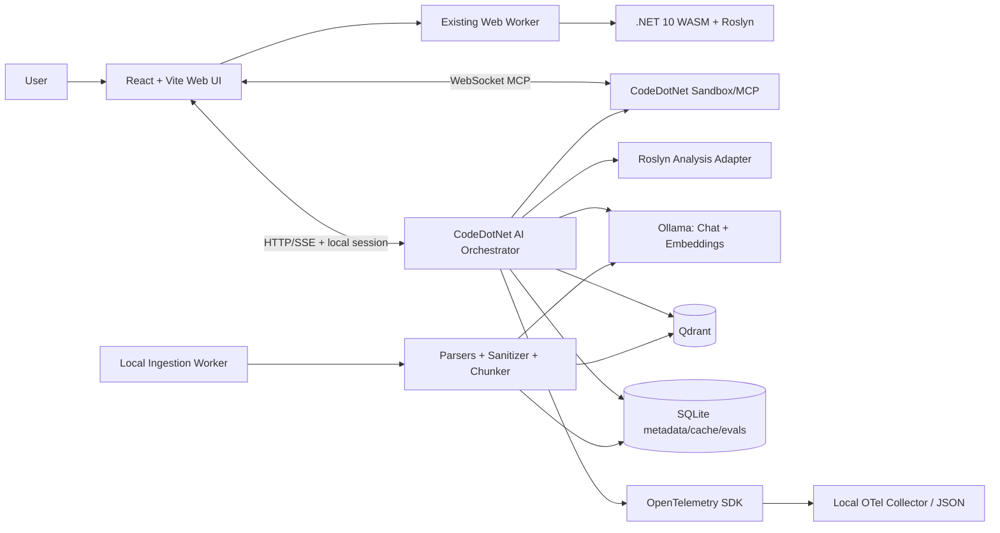
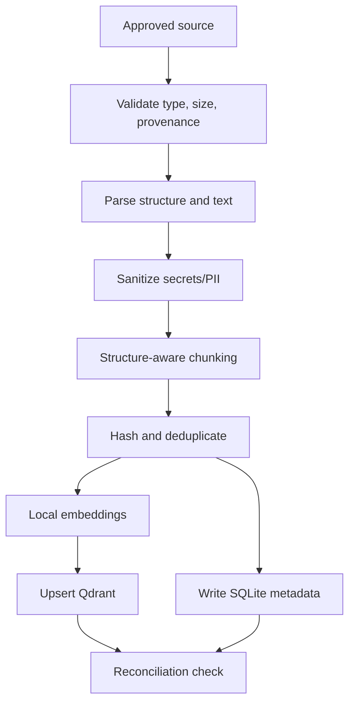
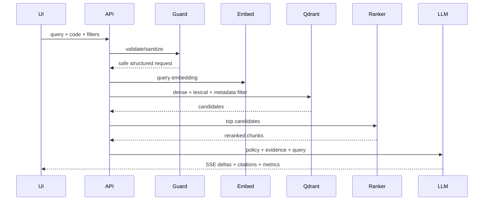
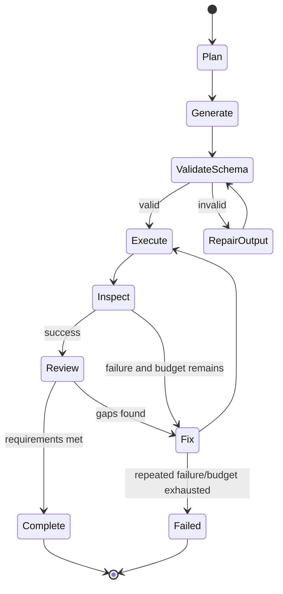

# CodeDotNet AI Expansion
## Zero-Cost Feasibility Study, AI-SRS, Technical Design, Security, Evaluation, API, and LLMOps Plan

**Project:** `hunk7/codedotnet`  
**Document status:** Proposed implementation baseline  
**Version:** 1.0  
**Date:** 25 October 2026  
**Target:** Local-first, open-source, zero recurring cloud cost  
**Primary stack:** React, TypeScript, Vite, .NET 10 WebAssembly, Roslyn, Node.js 22+, MCP, Ollama, Qdrant, SQLite, OpenTelemetry  

---

## Document Control

| Item | Value |
|---|---|
| Owner | CodeDotNet maintainer |
| Intended readers | Maintainers, contributors, reviewers, security reviewers, interviewers |
| Decision scope | Addition of RAG, local LLMs, code review, debugging, test generation, interview mode, semantic code search, and autonomous MCP agents |
| Cost constraint | No mandatory paid API, managed vector database, hosted model, or paid observability service |
| Deployment boundary | Static web app remains deployable to GitHub Pages; AI runtime runs locally on the user's machine |
| Privacy posture | Source code and prompts stay local by default |
| Normative terms | **MUST**, **SHOULD**, and **MAY** indicate requirement strength |

## Executive Summary

Adding all proposed AI features is technically feasible without paying for Azure OpenAI or another hosted model, provided that the AI-enabled experience is **local-first**. The existing GitHub Pages deployment cannot itself run a large language model, vector database, ingestion service, or long-running agent. Therefore, the browser UI remains static while a new local service, `codedotnet-ai`, runs alongside the existing `codedotnet-sandbox` process.

The recommended zero-cost baseline is:

- **Ollama** for local chat, code-generation, reranking-by-LLM, and embedding inference.
- **Qdrant Community Edition** in Docker for vector and hybrid retrieval.
- **SQLite** for document registry, chat metadata, feedback, job state, evaluation results, and audit events.
- **Roslyn** for deterministic syntax, semantic, diagnostic, security, and complexity signals before any LLM call.
- **Existing MCP `compile_and_run`** tool for execution, with additional read-only or tightly scoped tools.
- **OpenTelemetry** plus local JSON/SQLite logs for traces, metrics, and troubleshooting.
- **Ragas or a custom deterministic evaluation harness** for RAG quality gates, using local models only.
- **GitHub Actions** for deterministic unit, integration, security, schema, and golden-dataset regression tests. AI tests requiring downloaded model weights run locally or on an optional self-hosted runner, not on standard hosted runners.

The software is free, but computing is not resource-free. Users supply CPU, RAM, disk, and optionally a GPU. A practical developer baseline is 16 GB RAM, 15-30 GB of free disk, and a modern 6-core CPU. An 8 GB VRAM GPU improves latency but is not mandatory. Smaller quantized models should be the default.

### Feasibility verdict

| Area | Verdict | Key condition |
|---|---|---|
| Local RAG | Feasible | Local ingestion service and vector store must be running |
| AI code review | Highly feasible | Roslyn-first pipeline limits hallucinations |
| AI debugging | Highly feasible | Existing diagnostics, stdout, stderr, exception, and timing data are ideal context |
| Unit-test generation | Feasible | Generated tests must compile and run in an isolated loop |
| Semantic code search | Feasible | Repository/snippets must be chunked with code-aware metadata |
| C# interview mode | Feasible | Rubric and deterministic execution must score answers |
| Autonomous coding agent | Feasible with controls | Bounded iterations, timeouts, tool allowlists, and cancellation are mandatory |
| Multi-agent workflow | Feasible, lower initial priority | Adds latency and complexity; implement after single-agent stability |
| Public zero-cost hosted AI | Not generally feasible | GitHub Pages is static and cannot provide free persistent inference for arbitrary traffic |
| Local zero-recurring-cost AI | Feasible | User installs/runs local dependencies and model weights |

---

# Part I: Product Vision and Feasibility

## 1. Product Vision

CodeDotNet evolves from a browser-based C# playground into a **local-first AI-assisted C# engineering and learning platform**. It combines deterministic Roslyn analysis, retrieval-grounded .NET knowledge, sandboxed execution, and MCP tool use.

The platform SHALL help a user:

1. Ask grounded questions about C#, .NET, Roslyn, ASP.NET Core, and CodeDotNet.
2. Review active editor code for correctness, maintainability, performance, and security.
3. Diagnose compiler errors, runtime exceptions, failing output, and complexity problems.
4. Generate and validate xUnit tests.
5. Search documentation and saved code semantically.
6. Practise C# interviews with executable exercises and structured rubrics.
7. Run a bounded agent that writes, compiles, executes, diagnoses, and repairs code.
8. Inspect every retrieval, prompt, tool call, citation, and evaluation signal.

## 2. Guiding Principles

1. **Deterministic before probabilistic:** Roslyn diagnostics and rules are authoritative inputs, not something the model guesses.
2. **Local by default:** No source code, prompt, document, or telemetry leaves the machine unless a future opt-in provider is configured.
3. **Grounded by default:** Knowledge answers cite retrieved chunks. If evidence is insufficient, the assistant says so.
4. **Zero recurring mandatory cost:** Core functionality has no dependency on a metered API.
5. **Provider abstraction:** Ollama is the default, but model providers remain replaceable.
6. **Bounded agency:** Every agent has a step budget, token/context budget, execution timeout, cancellation path, and tool allowlist.
7. **Transparent operation:** The UI exposes sources, retrieval scores, model identity, prompt version, tool calls, and timings.
8. **Safe execution:** Generated code receives no ambient secrets and executes in the existing disposable sandbox.
9. **Progressive enhancement:** The non-AI playground remains fully usable when local AI services are absent.

## 3. Zero-Cost Definition

“Free” means:

- No mandatory paid subscription or pay-per-token API.
- No mandatory managed database or hosted compute.
- Open-source or freely usable local components.
- Existing GitHub Pages hosting remains the public static demo.
- Local CPU/GPU, electricity, storage, and internet downloads are supplied by the user and are not monetarily guaranteed to be zero.

It does **not** mean:

- Unlimited free public inference.
- Guaranteed low latency on all hardware.
- Free enterprise support.
- Permission to ingest copyrighted or restricted content. Documentation licensing and crawl rules still apply.

## 4. Proposed Free Technology Baseline

| Capability | Baseline | Alternative | Rationale |
|---|---|---|---|
| Local LLM runtime | Ollama | llama.cpp server, LocalAI | Simple local API and broad model support |
| Chat/code model | A current small code-capable model available in Ollama, selected by benchmark | Phi-family, Qwen-Coder-family, Llama-family, Mistral-family | Model names/tags change; pin a tested model in config |
| Embeddings | Ollama embedding model | FastEmbed / ONNX sentence-transformer | One local runtime; same model for index and query |
| Vector store | Qdrant CE in Docker | Qdrant embedded/edge, SQLite-vector extension | Hybrid dense + lexical retrieval and metadata filtering |
| Metadata store | SQLite | LiteDB | Portable, local, transactional |
| Orchestration | Custom TypeScript service | Semantic Kernel in .NET | Minimizes abstractions and fits existing Node MCP layer |
| Parsing | AngleSharp/HTML parser, Markdig, PdfPig, Open XML SDK or Node equivalents | Apache Tika container | Use format-specific parsers and preserve source structure |
| Reranking | Local cross-encoder via ONNX/FastEmbed | Reciprocal Rank Fusion; local LLM | Cross-encoder quality without paid API |
| Telemetry | OpenTelemetry + local OTLP collector | Structured logs only | Vendor-neutral traces, metrics, logs |
| Evaluation | Ragas plus deterministic tests | DeepEval/custom harness | Golden data and repeatable RAG metrics |
| Cache | SQLite or in-memory LRU | Redis local container | Avoid another mandatory service initially |
| Secret scanning | Gitleaks in CI/local | TruffleHog | Prevent prompting or committing secrets |
| Dependency scanning | Dependabot, npm audit, dotnet list package --vulnerable | OSV-Scanner | Already compatible with repository workflows |

## 5. Hardware Profiles and Expected Experience

These are engineering targets, not guarantees. Measure on representative machines.

| Profile | Suggested hardware | Default model class | Expected use |
|---|---|---|---|
| Minimum | 8 GB RAM, 4 CPU cores, 10-15 GB disk | 1B-3B quantized | Basic Q&A, embedding, short review; slower generation |
| Recommended | 16 GB RAM, 6-8 CPU cores, 20-30 GB disk | 3B-8B quantized | Full RAG, debugging, review, bounded agents |
| Enhanced | 32 GB RAM and 8-12 GB VRAM | 7B-14B quantized where supported | Faster responses and stronger iterative coding |

The application MUST detect unavailable Ollama/Qdrant services, report actionable setup instructions, and preserve all non-AI features.

## 6. Features Included in Scope

### 6.1 Grounded C#/.NET Assistant

- Natural-language Q&A.
- RAG over approved .NET documentation, CodeDotNet docs, curated code examples, and user-uploaded documents.
- Hybrid retrieval, reranking, citations, and “insufficient evidence” behavior.
- Streaming answer UI.

### 6.2 AI Code Reviewer

- Correctness, readability, performance, security, API usage, async, allocations, disposal, nullability, concurrency, and testability.
- Roslyn findings are mapped to exact file/line/column ranges.
- AI explanations link back to deterministic diagnostics where available.
- Severity, confidence, suggested patch, and validation status.

### 6.3 AI Debugging Assistant

- Uses source code, compiler diagnostics, stdout, stderr, stack trace, timing, and recent edit diff.
- Produces root-cause hypotheses, evidence, fix options, and a validated patch where possible.
- Re-runs code only with explicit or configured bounded agent permission.

### 6.4 Complexity and Optimization Assistant

- Retains deterministic complexity estimation.
- Adds explanation, hot-path identification, data-structure alternatives, and before/after benchmarks.
- Clearly labels estimated versus measured performance.

### 6.5 Semantic Code Search

- Indexes saved snippets, examples, generated solutions, and optionally a selected repository.
- Supports queries such as “shortest path with non-negative weights” without exact keyword matching.
- Returns code excerpts, symbol names, file paths, and relevance scores.

### 6.6 Unit-Test Generator

- Generates xUnit tests and edge cases.
- Compiles and runs generated tests in isolation.
- Reports compile status, pass/fail, coverage proxy or mutation score when configured, and untested behavior.
- Never labels tests “validated” unless execution succeeds.

### 6.7 Mock Interviewer

- Junior, mid, senior, and staff tracks.
- Topic selection: C#, .NET runtime, ASP.NET Core, distributed systems, Azure concepts, DSA, testing, architecture.
- Executes coding answers, applies a published rubric, and stores user-controlled local history.
- Separates correctness, complexity, communication, trade-offs, and code quality.

### 6.8 Autonomous MCP Coding Agent

- Planner creates a bounded plan.
- Coder proposes code.
- Executor calls `compile_and_run`.
- Debugger consumes structured failures.
- Reviewer checks requirements and tests.
- Loop ends on success, budget exhaustion, blocked policy, repeated failure, or cancellation.

### 6.9 Multi-Agent Workflow

Logical roles MAY use one model with different prompts rather than multiple model processes:

- Planner
- Coder
- Test designer
- Executor/tool router
- Reviewer
- Fixer

The first release SHOULD implement these as explicit states in one orchestrator, not independent autonomous services.

### 6.10 Architecture and Repository Explainer

- Parses solution/project structure and Roslyn symbols.
- Produces dependency summaries, component responsibilities, coupling warnings, and Mermaid diagrams.
- Repository access is limited to a user-approved root.

---

# Part II: Software Requirements Specification Addendum / AI-SRS

## 1. Introduction and Objectives

### 1.1 Purpose

This addendum defines the functional and non-functional contract for AI workloads added to CodeDotNet. It supplements existing architecture, testing, security, privacy, deployment, limitation, and ADR documents.

### 1.2 Business and User Problems

The AI extension solves:

- Keyword-only discovery across technical documentation.
- Difficulty converting compiler/runtime output into an actionable explanation.
- Lack of contextual code review in a browser playground.
- Manual iteration between code generation, compilation, testing, and repair.
- Lack of grounded citations in generic coding assistants.
- Fragmented interview preparation without executable validation.

### 1.3 Goals

- Deliver every listed AI feature with a local no-subscription path.
- Keep the static playground operational without AI services.
- Produce source-grounded answers and traceable tool execution.
- Demonstrate production-oriented RAG, agent, security, evaluation, and observability design.

### 1.4 Non-Goals

- Training a foundation model.
- Hosting unlimited public inference on GitHub Pages.
- Replacing a full IDE, package manager, or production SAST platform.
- Automatically modifying arbitrary user repositories without user-selected scope.
- Guaranteeing correctness solely from an LLM response.

### 1.5 Definitions and Glossary

| Term | Definition |
|---|---|
| Agent | A bounded orchestrator that selects tools and iterates toward a goal |
| BM25 | Lexical ranking function based on term frequency and document statistics |
| Chunk | Retrieval unit derived from a document or code structure |
| Context window | Maximum model input/output token budget |
| Cosine similarity | Vector similarity measure based on angle between vectors |
| Dense embedding | Fixed-length semantic vector generated from content |
| Groundedness | Degree to which an answer is supported by retrieved evidence |
| Hallucination | Unsupported or fabricated claim presented as factual |
| HNSW | Approximate-nearest-neighbor graph index |
| Hybrid search | Fusion of lexical and dense-vector retrieval |
| MCP | Open protocol for connecting AI clients to tools and data sources |
| Prompt injection | Untrusted content designed to override system/tool instructions |
| RAG | Retrieval-Augmented Generation using external evidence at response time |
| Reranker | Model or algorithm that reorders retrieved candidates for relevance |
| RRF | Reciprocal Rank Fusion combining ranked result lists |
| TTFT | Time to first generated token |
| Tombstone | Deletion marker preventing removed content from retrieval |
| Tool call | Structured model request to invoke an allowlisted operation |
| Vector database | Store optimized for similarity search over embeddings |

## 2. Legacy System Delta and Impact Assessment

### 2.1 Existing Touchpoints

| Existing area | Change |
|---|---|
| `codedotnet.web` | Add AI workspace, source panel, agent timeline, model status, settings, feedback, and SSE client |
| `codedotnet.compiler` | Expose richer Roslyn analysis DTOs; retain WebAssembly boundary |
| `codedotnet.compiler.tests` | Add deterministic analyzer and serialization regression tests |
| `codedotnet-sandbox` | Retain isolated execution; add authenticated local bridge and additional safe MCP tools |
| `docs` | Add AI architecture, model setup, data governance, evaluation, threat model, and ADRs |
| GitHub Actions | Add schema checks, prompt/eval fixtures, SAST, SBOM, and optional self-hosted AI eval job |
| GitHub Pages | Remains static; shows local runtime connection state and setup guidance |

### 2.2 New Modules

```text
codedotnet-ai/
  src/
    api/
    orchestration/
    providers/
    retrieval/
    ingestion/
    reranking/
    agents/
    guardrails/
    telemetry/
    persistence/
  prompts/
  schemas/
  evals/
  migrations/
  tests/
```

Optional:

```text
codedotnet.roslyn.analysis/
  Analyzers/
  Contracts/
  Services/
```

### 2.3 Compatibility

- Existing editor/run behavior MUST remain backward compatible.
- AI contracts MUST be versioned under `/v1/ai`.
- Existing `compile_and_run` MCP schema MUST not change incompatibly; a new tool version or optional fields shall be used.
- Indexed data MUST include `embeddingModelId` and `embeddingDimension`; changing either requires re-indexing.
- Prompt templates MUST have immutable version identifiers.

### 2.4 Dependency Changes

Expected new local dependencies:

- Ollama runtime and selected model weights.
- Qdrant container or embedded deployment.
- SQLite library.
- OpenTelemetry SDK/exporter.
- Parser libraries for allowed formats.
- Optional local reranker runtime.

No dependency SHALL be added without license review, security scan, and THIRD-PARTY-NOTICES update where necessary.

## 3. Personas and User Journeys

### 3.1 Learner

Writes a C# solution, runs it, receives a compiler error, clicks **Explain**, views a grounded explanation, applies a patch, and reruns.

### 3.2 Senior Developer

Loads a code sample, requests review, examines Roslyn-backed findings, generates tests, and validates improvements.

### 3.3 Interview Candidate

Starts a senior C# exercise, clarifies constraints, writes code, executes tests, and receives rubric-based feedback.

### 3.4 Agent/Tool Consumer

Connects through MCP, discovers tools, submits a coding goal, observes bounded tool calls, and receives structured results.

## 4. Functional Requirements

### 4.1 Model Runtime and Provider Management

- **FR-AI-001:** The system MUST support Ollama as the default local chat and embedding provider.
- **FR-AI-002:** The system MUST expose provider health, loaded model, model tag/digest where available, context length, and capabilities.
- **FR-AI-003:** The system MUST reject incompatible embedding dimensions before writing to an existing index.
- **FR-AI-004:** The system MUST support streaming generation and cancellation.
- **FR-AI-005:** Provider interfaces SHOULD permit future opt-in Azure OpenAI, GitHub Models, or OpenAI-compatible providers without changing domain services.
- **FR-AI-006:** Remote providers MUST be disabled by default and MUST never receive data without explicit configuration.

### 4.2 Ingestion and Synchronization

- **FR-ING-001:** Users MUST be able to ingest approved HTML, Markdown, text, PDF, DOCX, C# files, and repository folders.
- **FR-ING-002:** Every source MUST receive a stable `documentId`, source URI/path, title, content hash, license/provenance label, timestamps, and access scope.
- **FR-ING-003:** The pipeline MUST perform MIME/type validation instead of trusting extensions.
- **FR-ING-004:** The system MUST normalize text while retaining headings, page numbers where extractable, code fences, symbol names, and source offsets.
- **FR-ING-005:** Re-ingestion MUST be idempotent using a content hash.
- **FR-ING-006:** Delta synchronization MUST add changed chunks, retain unchanged vectors where valid, and tombstone removed chunks.
- **FR-ING-007:** Scheduled crawling MAY run locally, but MUST honor robots.txt, source licenses, rate limits, and configured allowlists.
- **FR-ING-008:** The user MUST be able to cancel, retry, inspect, and delete ingestion jobs.
- **FR-ING-009:** Deleting a document MUST delete/tombstone chunks, cache entries, and associated metadata.

### 4.3 Chunking

- **FR-CHK-001:** Documentation SHOULD be split by heading/paragraph boundaries, targeting 350-700 tokens with 50-100 token overlap.
- **FR-CHK-002:** Code MUST be split by Roslyn structures such as namespace, type, method, property, and top-level statement before token-size fallback.
- **FR-CHK-003:** A chunk MUST contain enough parent context: document title, heading path, namespace/type, and neighboring signature where relevant.
- **FR-CHK-004:** Chunk identifiers MUST be deterministic from document ID, version, and source span.
- **FR-CHK-005:** Chunking evaluation MUST compare at least two configurations against the golden dataset before a default change.

### 4.4 Query Processing and Retrieval

- **FR-RET-001:** The query pipeline MUST accept a natural-language question plus optional active code, diagnostics, conversation ID, and filters.
- **FR-RET-002:** Retrieval MUST combine dense semantic search with lexical search.
- **FR-RET-003:** Metadata filters MUST execute before or during retrieval, never only after answer generation.
- **FR-RET-004:** The baseline SHOULD retrieve 20-40 candidates, fuse rankings, rerank the top 10-20, and supply 4-8 chunks to generation.
- **FR-RET-005:** The system MUST deduplicate near-identical chunks and avoid filling context with adjacent duplicates.
- **FR-RET-006:** The system MUST expose retrieved chunk IDs, scores, rerank scores, and inclusion/exclusion outcome in debug mode.
- **FR-RET-007:** If no item meets the empirically selected threshold, the assistant MUST return an insufficient-evidence response instead of inventing an answer.
- **FR-RET-008:** Query rewriting MUST preserve identifiers, version numbers, C# symbols, diagnostic IDs, and quoted text.

### 4.5 Context Assembly and Generation

- **FR-GEN-001:** The context budget MUST reserve capacity separately for system policy, retrieved evidence, code/diagnostics, chat summary, user query, and output.
- **FR-GEN-002:** Retrieved documents MUST be delimited and explicitly treated as untrusted data, not instructions.
- **FR-GEN-003:** Knowledge answers MUST cite chunk IDs that map to source title and URI/path.
- **FR-GEN-004:** Streaming MUST deliver status events, citations, tokens/deltas, completion metadata, and terminal errors.
- **FR-GEN-005:** Structured tasks MUST request and validate JSON against a schema.
- **FR-GEN-006:** A generation failing schema validation MAY be repaired once; otherwise return a typed validation error.

### 4.6 Code Review

- **FR-REV-001:** Review MUST run deterministic Roslyn analysis first.
- **FR-REV-002:** Findings MUST contain category, severity, confidence, file, range, evidence, explanation, recommendation, and optional patch.
- **FR-REV-003:** The model MUST not claim a diagnostic is produced by Roslyn unless a diagnostic ID is present.
- **FR-REV-004:** Suggested patches MUST be syntax-checked and SHOULD be compiled before being marked validated.
- **FR-REV-005:** Users MUST be able to accept/reject each patch independently.

### 4.7 Debugging

- **FR-DBG-001:** Debug context MUST include compiler diagnostics, runtime exception, stack trace, stdout/stderr, timings, and active source.
- **FR-DBG-002:** The response MUST distinguish observed facts, hypotheses, and proposed validation steps.
- **FR-DBG-003:** Automated reruns MUST use bounded attempts and retain an iteration timeline.
- **FR-DBG-004:** The system MUST detect repeated equivalent failures and stop the loop.

### 4.8 Test Generation

- **FR-TST-001:** Tests MUST target xUnit initially.
- **FR-TST-002:** Generated tests SHOULD include happy path, boundaries, null/empty input where legal, exceptions, and relevant complexity cases.
- **FR-TST-003:** Generated tests MUST compile before display as validated.
- **FR-TST-004:** The system MUST not silently change production code merely to make generated tests pass.
- **FR-TST-005:** Test adequacy MAY use mutation testing locally through Stryker.NET where the project shape permits it.

### 4.9 Interview Mode

- **FR-INT-001:** Questions MUST have explicit topic, level, time budget, rubric, reference solution properties, and hidden tests.
- **FR-INT-002:** Scoring MUST combine executable correctness with rubric dimensions.
- **FR-INT-003:** The platform MUST disclose that AI feedback is advisory.
- **FR-INT-004:** History MUST remain local and be deletable.

### 4.10 Agent Mode

- **FR-AGT-001:** Default maximum iterations: 6; configurable hard ceiling: 10.
- **FR-AGT-002:** Default wall-clock budget: 90 seconds excluding initial model load; configurable hard ceiling: 5 minutes.
- **FR-AGT-003:** Allowed tools MUST be declared per workflow.
- **FR-AGT-004:** Tool arguments and responses MUST be schema-validated.
- **FR-AGT-005:** Agents MUST not access environment variables, arbitrary filesystem paths, network destinations, or shell commands.
- **FR-AGT-006:** Every step MUST be cancellable and logged.
- **FR-AGT-007:** The agent MUST stop on success, budget exhaustion, cancellation, policy block, service failure, or repeated non-progress.
- **FR-AGT-008:** Final output MUST include result, validation evidence, unresolved risks, and iteration summary.

### 4.11 Feedback

- **FR-FBK-001:** Users MUST be able to submit thumbs up/down and categorical reasons.
- **FR-FBK-002:** Feedback records MUST include trace ID, feature, prompt version, model ID, retrieval IDs, and optional correction.
- **FR-FBK-003:** Source code MUST not be copied into feedback unless the user explicitly opts in.

## 5. AI-Specific Non-Functional Requirements

### 5.1 Latency

Local inference varies by hardware, so report percentile targets per hardware profile.

- Retrieval-only p95: under 750 ms after warm-up for 100,000 chunks on the recommended profile.
- Embedding query p95: under 500 ms after model warm-up.
- TTFT warm p50 target: under 2 seconds on a supported GPU, under 6 seconds CPU-only.
- End-to-end short grounded answer p50 target: under 15 seconds on recommended hardware.
- UI cancellation acknowledgement: under 250 ms.
- Compiler/run timings remain separately reported and MUST not be hidden inside AI latency.

### 5.2 Throughput and Concurrency

- Default local concurrent generations: 1.
- Concurrent retrieval requests: 4.
- Agent executions: 1 per local runtime by default.
- Ingestion embedding batch size: configurable, beginning at 16-32 chunks.
- Backpressure MUST return queue position or `429 LOCAL_CAPACITY_EXCEEDED` with retry guidance.

### 5.3 Availability and Fallbacks

| Failure | Required behavior |
|---|---|
| Ollama unavailable | Disable generative controls; retain compile/run and deterministic Roslyn output |
| Chat model missing | Show exact pull/config action; do not auto-download without consent |
| Embedding model missing | Disable ingestion/query retrieval; retain already available non-RAG features |
| Qdrant unavailable | Fall back to lexical SQLite FTS5 if implemented; otherwise show degraded status |
| Reranker unavailable | Use RRF/hybrid fused order |
| Model timeout | Cancel generation, persist trace metadata, offer retry with smaller context/model |
| Sandbox unavailable | Permit explanation/review but mark execution validation unavailable |
| Corrupt index | Quarantine collection, restore snapshot or re-index from document registry |

### 5.4 Quality

- Citation precision target: at least 95% on golden set.
- Retrieval Recall@10 target: at least 0.85.
- Answer relevance target: at least 0.80 normalized evaluator score.
- Groundedness target: at least 0.90.
- Unsupported factual claim rate: below 5% on curated test set.
- Code patch compile-success target: at least 85% for supported single-file tasks.
- Agent solve rate SHALL be reported by task category, never as a single unqualified number.

### 5.5 Reliability

- Ingestion jobs MUST be resumable or safely restartable.
- Writes to metadata and vector store MUST use an outbox/reconciliation pattern or equivalent recovery process.
- Every request MUST receive a trace ID.
- Prompt/model/index configuration MUST be captured for reproducibility.

### 5.6 Accessibility and UX

- Keyboard access, visible focus, screen-reader labels, reduced-motion support, and WCAG 2.2 AA color contrast targets.
- Streaming content MUST not steal focus.
- Citations and agent steps MUST be navigable without a mouse.
- Long operations MUST display status and cancellation.

## 6. Access Control and Authorization Boundaries

The initial local single-user edition uses a single owner boundary, but data models MUST be future-ready:

- `tenantId`
- `ownerId`
- `visibility`
- `allowedRoles[]`
- `sourceId`

Retrieval MUST apply access metadata as a vector-store filter. The application MUST never retrieve a broad set and rely on the LLM to hide unauthorized chunks.

Local service protections:

- Bind to `127.0.0.1` by default.
- Generate an ephemeral session secret during startup.
- Require an origin allowlist and session handshake for browser requests.
- Reject cross-site WebSocket/SSE connections.
- Do not expose Qdrant or Ollama to the LAN by default.

## 7. Acceptance Criteria

A release candidate is acceptable when:

1. Existing CodeDotNet tests pass.
2. All AI APIs conform to schemas.
3. The static site works with AI services absent.
4. RAG answers show working citations.
5. A deleted source can no longer be retrieved.
6. A prompt-injection fixture cannot invoke tools or override policy.
7. Generated code runs only inside the sandbox.
8. Agent budgets and cancellation are enforced.
9. Golden retrieval/evaluation thresholds pass.
10. No secrets appear in committed fixtures, logs, or traces.

---

# Part III: System Architecture Document / Technical Design

## 1. High-Level Architecture



### 1.1 Static-versus-local Boundary

The GitHub Pages application remains static. Browser AI requests target an explicitly configured local loopback endpoint such as `http://127.0.0.1:7901`. The page MUST clearly show whether the local AI runtime and sandbox are connected. HTTPS-page-to-HTTP-loopback restrictions and browser policies must be tested; a local HTTPS endpoint, browser launch mode, or a packaged desktop wrapper may be needed for a frictionless future experience.

### 1.2 Trust Boundaries

1. Public static origin.
2. Local browser state.
3. Local AI orchestrator.
4. Local model runtime.
5. Local vector/metadata stores.
6. Disposable execution sandbox.
7. Untrusted indexed documents.
8. Untrusted generated code.

## 2. Component Responsibilities

### 2.1 Web UI

- Feature tabs/panels.
- Provider and model setup status.
- Streaming renderer.
- Citation viewer.
- Diff/patch application.
- Agent timeline and cancellation.
- Feedback UI.
- Local privacy controls.

### 2.2 AI Orchestrator

- API contracts and schema validation.
- Workflow state machines.
- Context budgeting.
- Provider abstraction.
- Retrieval and reranking.
- Guardrails.
- Tool routing.
- Trace creation.
- Persistence.

### 2.3 Roslyn Analysis Adapter

Returns a structured envelope:

```json
{
  "syntax": { "types": [], "methods": [], "invocations": [] },
  "diagnostics": [],
  "symbols": [],
  "controlFlow": {},
  "dataFlow": {},
  "complexitySignals": {},
  "sourceHash": "sha256:..."
}
```

Large syntax trees MUST not be inserted wholesale into prompts. The adapter outputs compact task-specific facts.

### 2.4 Execution Sandbox

- Existing disposable child-process isolation.
- Hard timeout.
- Captured stdout/stderr.
- Structured diagnostics.
- No environment secrets.
- No unrestricted network.
- Payload and output limits.

### 2.5 Storage

- Qdrant: chunks, dense vectors, optional sparse representations, retrieval payload.
- SQLite: documents, versions, jobs, conversations, feedback, prompt registry, traces index, evaluation results, cache, tombstones.

## 3. RAG Ingestion Pipeline



### 3.1 Source Policies

Each source needs:

- Owner/provenance.
- License or usage basis.
- Allowed path/domain.
- Crawl interval.
- Retention.
- Visibility/access scope.
- Deletion mechanism.

For Microsoft documentation, prefer approved repository/source mechanisms and retain canonical links. Do not build an uncontrolled crawler.

### 3.2 Parsers

| Format | Required extraction |
|---|---|
| HTML | Title, canonical URL, headings, paragraphs, lists, tables, code blocks |
| Markdown | Front matter, heading path, prose, fenced code language |
| PDF | Page number, text blocks; reject scanned-only content unless optional local OCR is installed |
| DOCX | Headings, paragraphs, tables, lists, document properties |
| C# | Namespace, type, member, signature, XML docs, source range |
| Repository | Project/solution graph, file metadata, symbol index, README/docs |

### 3.3 Chunking Strategy

Documentation:

1. Split on heading hierarchy.
2. Preserve code blocks with explanatory paragraph.
3. Target 512 tokens.
4. Use 64-token overlap only when semantic continuity requires it.
5. Avoid splitting tables mid-row.

C#:

1. One member per chunk when size permits.
2. Include containing namespace/type and signature.
3. Keep XML docs with symbol.
4. For large methods, split by logical blocks with source spans.
5. Create separate symbol-summary records for navigation.

### 3.4 Metadata Schema

```json
{
  "chunkId": "doc:version:span-hash",
  "documentId": "uuid",
  "documentVersion": 3,
  "sourceType": "html|pdf|docx|markdown|csharp|repository",
  "sourceUri": "...",
  "title": "...",
  "headingPath": ["C#", "Async", "Cancellation"],
  "page": 12,
  "language": "en",
  "codeLanguage": "csharp",
  "namespace": "System.Example",
  "symbol": "Example.RunAsync",
  "contentHash": "sha256:...",
  "embeddingModelId": "configured-model@digest",
  "embeddingDimension": 768,
  "visibility": "private",
  "allowedRoles": ["owner"],
  "createdAt": "ISO-8601",
  "deletedAt": null
}
```

Dimensions are illustrative and MUST be discovered from the configured embedding model.

## 4. Retrieval Design

### 4.1 Query Flow



### 4.2 Hybrid Retrieval

Recommended baseline:

- Dense top 30.
- Lexical/BM25 top 30.
- Fuse with RRF.
- Deduplicate by content hash and adjacency.
- Rerank top 15.
- Select top 6 subject to token budget and diversity.

Identifiers such as `CS8602`, `Span<T>`, `IAsyncEnumerable<T>`, method names, and version numbers benefit greatly from the lexical side. Conceptual questions benefit from dense retrieval.

### 4.3 Reranking

Priority order:

1. Local cross-encoder if installed and benchmarked.
2. RRF plus deterministic boosts for exact diagnostic/symbol/version matches.
3. Local LLM listwise reranking only when latency is acceptable.

Never use the generator's eloquence as evidence of retrieval quality.

### 4.4 Citation Contract

Every cited claim maps to:

- `chunkId`
- `documentId`
- title
- canonical path/URI
- page or heading and source range
- excerpt used
- retrieval/rerank score

The UI resolves `[S1]`, `[S2]` markers to a source drawer. Invalid citation IDs fail post-generation validation.

## 5. Orchestration and LLM Integration

### 5.1 Provider Interfaces

```text
IChatProvider
- health()
- capabilities()
- streamChat(request, cancellationToken)
- generateStructured(request, schema)

IEmbeddingProvider
- dimensions(model)
- embedOne(text)
- embedBatch(texts)

IReranker
- rerank(query, candidates)
```

### 5.2 Context Budget

For a hypothetical 16k-token model:

- System and safety policy: 1,200.
- Workflow instructions/schema: 1,300.
- Retrieved evidence: 5,500.
- Active code/diagnostics: 4,000.
- Conversation summary: 1,000.
- User query: 500.
- Output reserve: 2,500.

The actual allocator MUST read provider capability and trim in this order: redundant chat history, low-ranked chunks, secondary Roslyn facts. It MUST not truncate the user query or split a critical diagnostic.

### 5.3 Prompt Registry

Each prompt record contains:

- Prompt ID and semantic version.
- Feature/workflow.
- Template hash.
- Input/output schema versions.
- Model compatibility.
- Evaluation baseline.
- Change log.
- Rollback version.

Prompts are files in source control, not opaque strings embedded across source code.

### 5.4 Semantic Cache

Initial cache uses SQLite:

- Exact cache key: normalized query + code hash + retrieval filter + model digest + prompt version + index version.
- Optional semantic cache only for low-risk knowledge Q&A.
- Never reuse code-review/debug answers across different source hashes.
- TTL and deletion propagate from source changes.

## 6. Agent Architecture

### 6.1 State Machine



### 6.2 Tool Catalog

| Tool | Risk | Default |
|---|---:|---|
| `compile_and_run` | Medium | Enabled with limits |
| `analyze_code` | Low | Enabled |
| `search_dotnet_docs` | Low | Enabled |
| `generate_tests` | Medium | Workflow-scoped |
| `run_tests` | Medium | Sandboxed |
| `read_workspace_file` | Medium | Disabled until user selects root |
| `write_workspace_patch` | High | Requires preview/approval |
| Arbitrary shell | Critical | Not provided |
| Arbitrary network fetch | High | Not provided |

### 6.3 Non-Progress Detection

Hash normalized code, diagnostics, and test failures. Stop when:

- Same state repeats twice without meaningful diff.
- The model alternates between two states.
- New patch increases errors for two iterations.
- Tool call schema fails twice.
- Budget is exhausted.

### 6.4 Multi-Agent Design

Use a supervisor-owned blackboard containing only structured state. Roles do not freely message one another. Each role receives minimum required context. The reviewer cannot execute tools directly; it returns a decision to the supervisor. This avoids runaway delegation and simplifies tracing.

## 7. Legacy Integration Architecture

An anti-corruption layer maps current DTOs to AI-domain contracts. The AI orchestrator never reads internal compiler implementation objects directly. Async job work uses an in-process durable SQLite queue initially; RabbitMQ/Kafka would violate the minimal local footprint and are unnecessary at this scale.

Use transactional outbox records for:

- Document indexed.
- Document deleted.
- Embedding model changed.
- Re-index requested.
- Feedback received.

## 8. Deployment Topologies

### 8.1 Recommended Local Development

```text
GitHub Pages or Vite dev server
  + codedotnet-ai local process
  + codedotnet-sandbox local process
  + Ollama local process
  + Qdrant Docker container
  + SQLite files
```

### 8.2 Docker Compose Option

Containerize `codedotnet-ai`, Qdrant, and optional OTel Collector. Ollama can run on host for GPU access or in a supported container configuration. The sandbox remains isolated and should not share the Docker socket.

### 8.3 Offline Mode

After model/container/package artifacts are downloaded:

- Disable crawlers.
- Ingest local documents only.
- Use local models and stores.
- Retain full Q&A, review, debugging, tests, semantic search, and agents.

---

# Part IV: Data Governance and Security Specification

## 1. Data Classification

| Class | Examples | Default handling |
|---|---|---|
| Public | Open documentation with permitted use | May be indexed locally |
| Private | User code, local notes, interview history | Local only, no remote provider |
| Sensitive | Internal source, architecture, customer data | Reject or require explicit controlled profile |
| Secret | API keys, tokens, passwords, private keys | Redact/reject; never embed or log |
| Regulated | Personal, financial, health data | Out of scope for default edition |

## 2. Data Flow and Residency

All default data stays on loopback/local storage. No telemetry exporter may target an external endpoint unless the user opts in.

### 2.1 Encryption

- Traffic beyond loopback MUST use TLS 1.3 where supported.
- Local-only loopback traffic is still authenticated by session token and origin validation.
- Full-disk encryption is recommended for at-rest protection.
- Application-level encryption of SQLite/vector data MAY be added, but key management must not create false security.
- Backups containing private code must be encrypted by the user or excluded.

### 2.2 Retention

- Conversations: local, user configurable, default 30 days or “session only.”
- Detailed traces: default 7 days.
- Feedback/eval records: retained until user deletion.
- Documents/chunks: until removed by user/source sync.
- Raw prompts with code: disabled in normal logs; optional debug capture with warning and automatic expiry.

## 3. PII and Secret Sanitization

Before embedding, prompting, logging, or feedback persistence:

1. Detect common private-key blocks.
2. Detect known API/token prefixes.
3. Detect connection strings and password assignments.
4. Detect email, phone, card-like values, and configurable organization patterns.
5. Replace with typed placeholders preserving consistent references where useful.
6. Emit a local warning and allow the user to cancel ingestion.

High-entropy detection must be tuned to avoid flagging ordinary code hashes. Secret redaction happens both before model invocation and before telemetry.

## 4. Threat Model

### 4.1 Primary Threats

- Direct prompt injection by user input.
- Indirect prompt injection inside indexed docs or code comments.
- Tool-argument injection.
- Data exfiltration through generated output.
- Path traversal during repository/document ingestion.
- Zip bombs and oversized files.
- Browser-to-localhost cross-site request attacks.
- Model denial of service with huge context or infinite tool loops.
- Generated code escaping the sandbox.
- Poisoned retrieval index.
- Dependency/model supply-chain compromise.

### 4.2 Controls

- Treat retrieved text as quoted evidence, never instructions.
- Strong system policy and tool allowlists enforced in code.
- JSON-schema validation for all tools.
- Canonical-path checks and approved workspace root.
- File count, size, decompression ratio, page, and token limits.
- Loopback bind, origin checks, CSRF/session token, and CORS deny-by-default.
- Iteration/context/output limits.
- Disposable sandbox with no credentials and restricted network/filesystem.
- Content hashes, provenance, index versioning, and deletion reconciliation.
- Pin container images/dependencies/models where possible; record digests.

## 5. Input Guardrails

- Maximum query length and code size.
- Unicode normalization.
- MIME and parser validation.
- Prompt-injection heuristic labels.
- Policy classifier/rules before tool-enabled workflows.
- Reject instructions requesting secrets, sandbox escape, arbitrary shell/network access, or policy override.
- Agent goals are converted to a structured task; raw goal is never concatenated into tool instructions.

## 6. Output Guardrails

- JSON schema validation.
- Citation ID validation.
- PII/secret rescanning.
- Markdown sanitization; no unsafe HTML.
- Link protocol allowlist.
- Patch path validation.
- Generated code clearly marked untrusted until compiled/tested.
- Claims such as “tests passed” require a matching tool result in the same trace.

## 7. Model and Supply-Chain Governance

Maintain a model manifest:

```yaml
modelId: configured-local-model
purpose: chat-code
source: ollama-library-or-approved-registry
license: verify-before-distribution
quantization: configured
artifactDigest: recorded-at-install
contextWindow: discovered
approvedOn: YYYY-MM-DD
benchmarkVersion: eval-v1
```

Do not redistribute model weights without confirming the model license. Scanning OSS packages does not replace model-license review.

## 8. Security Testing

- OWASP ASVS-inspired API controls.
- OWASP Top 10 for LLM Applications test cases.
- Prompt-injection corpus.
- Path traversal and archive bomb tests.
- Cross-origin localhost request tests.
- Tool schema fuzzing.
- Agent budget/cancellation tests.
- Sandbox escape regression tests.
- Secret leakage fixtures.
- Dependency, container, SBOM, and license scans.

## 9. Privacy Controls

UI MUST provide:

- Local data inventory.
- Export of settings/history/evals.
- Delete conversation.
- Delete document and vectors.
- Clear all AI data.
- Disable persistence.
- Disable telemetry.
- Show exactly which provider receives a request.

---

# Part V: AI Evaluation and Quality Assurance Plan

## 1. Evaluation Philosophy

AI output is probabilistic, but the evaluation process must be repeatable. Quality is assessed at separate layers:

1. Parser/chunker correctness.
2. Embedding/index compatibility.
3. Retrieval quality.
4. Reranking quality.
5. Grounded generation.
6. Code compile/test correctness.
7. Tool/agent behavior.
8. Safety and privacy.
9. User-perceived usefulness.

## 2. Golden Dataset

Start with at least 150 curated cases:

| Category | Minimum cases |
|---|---:|
| C# language | 25 |
| .NET runtime/GC | 15 |
| Async/concurrency | 20 |
| ASP.NET Core | 15 |
| Roslyn/compiler diagnostics | 20 |
| Data structures/algorithms | 20 |
| Debugging | 15 |
| Security/safe coding | 10 |
| CodeDotNet architecture | 10 |

Each record includes:

```json
{
  "caseId": "rag-cs-001",
  "query": "...",
  "expectedDocumentIds": ["..."],
  "requiredFacts": ["..."],
  "forbiddenClaims": ["..."],
  "referenceAnswer": "...",
  "tags": ["csharp", "async"],
  "difficulty": "medium"
}
```

Include adversarial cases, ambiguous questions, no-answer cases, exact identifier/version questions, and multi-hop queries.

## 3. Core RAG Metrics

### 3.1 Retrieval

- Recall@5 and Recall@10.
- Precision@5.
- Mean Reciprocal Rank.
- nDCG@10.
- Exact source hit rate.
- No-answer retrieval rejection accuracy.

### 3.2 RAG Triad

- **Context relevance:** retrieved evidence addresses the question.
- **Groundedness/faithfulness:** claims are entailed by evidence.
- **Answer relevance:** answer directly resolves the request.

### 3.3 Citations

- Citation precision.
- Citation completeness.
- Broken citation rate.
- Correct source-span rate.

## 4. Code Feature Metrics

### 4.1 Code Review

- True-positive/false-positive rate against labeled findings.
- Exact source-range accuracy.
- Patch compile rate.
- Patch test-pass rate.
- Severity agreement.

### 4.2 Debugging

- Root cause top-1 accuracy.
- Correct fix compile/test rate.
- Number of agent iterations.
- Regression introduction rate.

### 4.3 Test Generation

- Compile rate.
- Test pass rate against expected behavior.
- Fault detection/mutation score where feasible.
- Duplicate/redundant test rate.
- Flaky test rate over repeated runs.

### 4.4 Agent

- Task success rate by category.
- Mean tool calls to success.
- Timeout/budget-exhaustion rate.
- Invalid tool-call rate.
- Repeated-state rate.
- Human patch acceptance rate.

## 5. Deterministic Test Layers

- Unit tests for chunk boundaries, hashes, filters, citations, schemas, budgeting, and redaction.
- Contract tests with fake model and fake Qdrant.
- Integration tests against local Qdrant/Ollama when available.
- End-to-end tests against a small pinned model on a self-hosted runner.
- Snapshot tests for prompts and structured outputs.
- Security regression fixtures.

## 6. LLM-as-Judge Controls

A local judge model may score outputs, but:

- Use explicit rubrics.
- Calibrate against human labels.
- Blind model identity/configuration.
- Run deterministic settings where supported.
- Keep rule-based metrics for citations and executable code.
- Never let an LLM judge be the sole release gate.

## 7. CI/CD Evaluation Gates

### Pull Request Gate

- Build/lint/unit tests.
- OpenAPI/JSON schema validation.
- Prompt snapshot diff.
- Retrieval tests using deterministic fixture embeddings or committed small vectors.
- Security/secret/dependency scans.

### Nightly or Self-Hosted Gate

- Local model golden dataset.
- RAG metrics.
- Agent tasks.
- Latency/resource benchmark.
- Model drift comparison.

### Suggested Release Thresholds

- Recall@10 >= 0.85.
- Groundedness >= 0.90.
- Citation precision >= 0.95.
- Broken citations = 0.
- Patch compile rate >= 0.85.
- Critical safety fixtures pass 100%.
- No regression greater than 3 percentage points without written approval.

## 8. Human Review

Sample at least 20 changed-output cases per prompt/model/index release. Review correctness, completeness, directness, safety, citations, and code quality. Record disagreement and update the golden dataset.

---

# Part VI: API Contract and Interface Specification

## 1. Protocol

- Local HTTP JSON APIs under `/v1/ai`.
- SSE for generation and agent timeline streaming.
- Existing MCP transport retained for tool interoperability.
- UTF-8, ISO-8601 timestamps, UUID/ULID request IDs.
- JSON Schema/OpenAPI source-controlled contracts.

## 2. Endpoints

| Method | Endpoint | Purpose |
|---|---|---|
| GET | `/v1/ai/health` | Aggregate service health |
| GET | `/v1/ai/models` | Available/configured local models |
| POST | `/v1/ai/query` | Grounded synchronous query |
| POST | `/v1/ai/query/stream` | Grounded SSE query |
| POST | `/v1/ai/review` | Code review |
| POST | `/v1/ai/debug` | Debug explanation/fix |
| POST | `/v1/ai/tests/generate` | Generate and validate tests |
| POST | `/v1/ai/search` | Semantic/hybrid search |
| POST | `/v1/ai/agents/runs` | Start bounded agent |
| GET | `/v1/ai/agents/runs/{id}` | Get run state |
| POST | `/v1/ai/agents/runs/{id}/cancel` | Cancel run |
| POST | `/v1/ai/documents/ingest` | Start ingestion |
| GET | `/v1/ai/documents/jobs/{id}` | Ingestion status |
| DELETE | `/v1/ai/documents/{id}` | Delete/tombstone document |
| POST | `/v1/ai/feedback` | Record local feedback |
| GET | `/v1/ai/traces/{id}` | Local trace detail, redacted |

## 3. Query Request Example

```json
{
  "requestId": "01J...",
  "conversationId": "01J...",
  "query": "Why does this async method deadlock?",
  "activeCode": {
    "language": "csharp",
    "content": "...",
    "sha256": "..."
  },
  "filters": {
    "sourceTypes": ["microsoft-docs", "codedotnet-docs"],
    "versions": ["net-10"]
  },
  "options": {
    "stream": true,
    "includeRetrievalDebug": false,
    "maxSources": 6
  }
}
```

## 4. Query Response Example

```json
{
  "requestId": "01J...",
  "traceId": "4bf92f...",
  "answer": "... [S1]",
  "citations": [
    {
      "id": "S1",
      "chunkId": "doc:v3:abc",
      "title": "Async programming scenarios",
      "sourceUri": "https://...",
      "heading": "Await tasks efficiently",
      "excerpt": "..."
    }
  ],
  "model": {
    "provider": "ollama",
    "id": "configured-model",
    "digest": "sha256:..."
  },
  "usage": {
    "inputTokensApprox": 3100,
    "outputTokensApprox": 420
  },
  "timingMs": {
    "retrieval": 180,
    "rerank": 120,
    "firstToken": 1450,
    "total": 6200
  },
  "grounding": {
    "status": "grounded",
    "insufficientEvidence": false
  }
}
```

## 5. SSE Events

```text
event: status
data: {"phase":"retrieving"}

event: sources
data: {"sources":[...]}

event: delta
data: {"text":"The exception occurs..."}

event: tool_call
data: {"name":"compile_and_run","callId":"...","state":"started"}

event: tool_result
data: {"callId":"...","state":"completed","summary":{...}}

event: complete
data: {"traceId":"...","citations":[...],"timingMs":{...}}
```

## 6. Error Contract

```json
{
  "error": {
    "code": "MODEL_UNAVAILABLE",
    "message": "The configured local chat model is not available.",
    "requestId": "01J...",
    "traceId": "...",
    "retryable": true,
    "details": {
      "provider": "ollama",
      "requiredModel": "configured-model"
    }
  }
}
```

Standard codes:

- `VALIDATION_ERROR`
- `MODEL_UNAVAILABLE`
- `EMBEDDING_MODEL_MISMATCH`
- `VECTOR_STORE_UNAVAILABLE`
- `INSUFFICIENT_EVIDENCE`
- `LOCAL_CAPACITY_EXCEEDED`
- `MODEL_TIMEOUT`
- `TOOL_NOT_ALLOWED`
- `TOOL_SCHEMA_ERROR`
- `SANDBOX_TIMEOUT`
- `AGENT_BUDGET_EXCEEDED`
- `PROMPT_INJECTION_BLOCKED`
- `DOCUMENT_TYPE_UNSUPPORTED`
- `DOCUMENT_TOO_LARGE`
- `INDEX_REBUILD_REQUIRED`

## 7. MCP Contract Extensions

Potential tools:

```text
compile_and_run
analyze_code
search_dotnet_docs
generate_unit_tests
run_unit_tests
explain_diagnostics
```

Every tool definition MUST include a strict input schema, output schema, timeout, maximum payload, risk classification, and whether user approval is required.

---

# Part VII: Operations and Observability Runbook / LLMOps

## 1. Observability

OpenTelemetry captures:

```text
HTTP request
  -> guardrail
  -> embedding
  -> dense retrieval
  -> lexical retrieval
  -> fusion
  -> reranking
  -> prompt assembly
  -> model generation
  -> tool call(s)
  -> post-validation
  -> response
```

### 1.1 Required Trace Attributes

- `ai.feature`
- `ai.prompt.id`
- `ai.prompt.version`
- `ai.model.provider`
- `ai.model.id`
- `ai.model.digest`
- `ai.embedding.model`
- `ai.index.version`
- `ai.retrieval.candidate_count`
- `ai.retrieval.selected_count`
- `ai.agent.iteration`
- `ai.tool.name`
- `ai.outcome`
- `ai.cache.hit`

Do not attach raw source code, full prompts, secrets, or private document text to normal telemetry.

### 1.2 Metrics

- Requests by feature/outcome.
- TTFT and total latency histograms.
- Retrieval/rerank latency.
- Prompt/context/output token estimates.
- Queue depth.
- Agent iterations and stop reasons.
- Compile/test success.
- Citation and schema validation failures.
- Ingestion documents/chunks/failures.
- Qdrant collection size and tombstones.
- Local model load and generation rate where available.

## 2. Cost and Quota Management

Monetary API spend is zero in the baseline. Resource quotas still apply:

- Maximum input context.
- Maximum output tokens.
- Maximum concurrent generation.
- Maximum agent steps/time.
- Maximum documents, file size, and index disk consumption.
- Configurable model idle unload/keep-alive.

The UI SHOULD show estimated disk usage, model footprint, vector count, and recent generation durations.

## 3. Index Maintenance

### Daily/on Startup

- Reconcile SQLite documents with Qdrant points.
- Process tombstones.
- Check embedding model/dimension compatibility.
- Report failed jobs.

### Scheduled

- Compact historical trace/feedback data.
- Snapshot Qdrant and SQLite before schema migrations.
- Re-index only changed documents.
- Run retrieval drift sample.

### Re-index Triggers

- Embedding model/dimension change.
- Material chunking algorithm change.
- Metadata schema/filter change.
- Source corruption.
- Evaluation regression requiring new indexing strategy.

## 4. Backup and Recovery

Backup:

- SQLite database using a consistent backup mechanism.
- Qdrant snapshot or rebuildable vector collection.
- Prompt/config/model manifest.
- Document source registry.

Preferred recovery order:

1. Restore SQLite/document registry.
2. Restore compatible Qdrant snapshot.
3. If incompatible/corrupt, recreate collection and re-embed.
4. Run reconciliation and golden smoke tests.

Since vectors are derivable, original permitted source material and metadata are more important than the index itself.

## 5. Troubleshooting Guides

### Ollama Unavailable

1. Check local service status.
2. Call provider health endpoint.
3. Confirm configured host is loopback.
4. Confirm model exists.
5. Check memory/disk.
6. Retry with smaller model.

### Embedding Dimension Mismatch

1. Stop ingestion.
2. Inspect index manifest.
3. Confirm configured embedding model and digest.
4. Create a new versioned collection.
5. Re-index; do not mix dimensions.

### Poor Retrieval

1. Inspect candidate chunks and filters.
2. Confirm source was ingested and not tombstoned.
3. Test lexical and dense paths separately.
4. Check chunk boundaries.
5. Check exact identifiers survived normalization.
6. Compare Recall@10 against baseline.
7. Tune fusion/reranker only after data issues are excluded.

### Hallucinated Answer

1. Preserve trace metadata, not secrets.
2. Validate cited chunks.
3. Check whether unsupported claim is linked to a source.
4. Tighten evidence threshold/prompt.
5. Add case to golden dataset.
6. Compare alternate model only after retrieval diagnosis.

### Agent Looping

1. Inspect normalized state hashes.
2. Confirm non-progress detector fired.
3. Reduce tool output/noise.
4. Add explicit success criteria.
5. Add hidden validation test.
6. Keep hard iteration ceiling.

## 6. Incident Severity

| Severity | Example | Response |
|---|---|---|
| SEV-1 | Secret exfiltration or sandbox escape | Disable affected AI/tool feature immediately; rotate exposed secrets; preserve evidence |
| SEV-2 | Unauthorized document retrieval or destructive workspace write | Disable workflow, invalidate sessions, investigate filters/approval path |
| SEV-3 | Widespread wrong citations, corrupted index, agent failures | Degrade to deterministic mode; rebuild/rollback |
| SEV-4 | Latency/model availability issue | Display degraded status and fallback |

---

# Part VIII: User Experience Specification

## 1. Information Architecture

Suggested top-level modes:

- Playground
- AI Assistant
- Review
- Debug
- Tests
- Search
- Interview
- Agent
- MCP Playground
- Knowledge Base
- Settings/Diagnostics

## 2. AI Assistant Layout

- Left: conversation and query input.
- Center: streamed response.
- Right: sources, retrieval details, model/runtime status.
- “Use active code” toggle with visible code hash/size.
- Clear local-processing badge.

## 3. Agent Timeline

Each step shows:

- Role/state.
- Goal.
- Tool name and sanitized arguments.
- Duration.
- Result summary.
- Code diff.
- Validation outcome.
- Stop reason.

The user can stop at any time and apply only selected changes.

## 4. Trust Indicators

Use explicit badges:

- **Roslyn diagnostic**
- **Retrieved source**
- **AI suggestion**
- **Compiled**
- **Tests passed**
- **Not validated**
- **Insufficient evidence**

Do not use one generic “AI verified” label.

---

# Part IX: Implementation Plan

## Phase 0: Architecture and Contracts, 1 Week

Deliverables:

- ADRs for local-first runtime, provider abstraction, Qdrant, SQLite, agent state machine, and privacy.
- OpenAPI/JSON schemas.
- Threat model.
- Prompt registry layout.
- Benchmark machine profiles.

Exit: contracts and trust boundaries reviewed.

## Phase 1: Local AI Foundation, 1-2 Weeks

- Add `codedotnet-ai` service.
- Ollama health/chat/embedding adapters.
- SSE streaming and cancellation.
- Provider/model settings UI.
- Local session handshake and origin controls.
- OTel basic tracing.

Exit: local model can stream a response; non-AI mode remains intact.

## Phase 2: Roslyn-First Review and Debug, 2 Weeks

- Structured Roslyn analysis contract.
- Review workflow.
- Debug workflow using existing execution outputs.
- Patch diff and compile validation.
- Deterministic test fixtures.

Exit: code review/debug findings are traceable and patches compile in supported cases.

## Phase 3: RAG Ingestion and Search, 2-3 Weeks

- Qdrant + SQLite stores.
- Markdown/HTML/text/C# ingestion first.
- Structure-aware chunking.
- Local embeddings.
- Hybrid retrieval, fusion, citations.
- Knowledge-base UI.

Exit: golden Recall@10 and citation gates pass.

## Phase 4: PDF/DOCX, Reranking, and Evaluation, 1-2 Weeks

- PDF/DOCX parsers.
- Local reranker or benchmarked fallback.
- Ragas/custom evaluation runner.
- Golden dataset and dashboard/report.
- Re-index/versioning workflow.

Exit: RAG triad/citation metrics captured in repeatable runs.

## Phase 5: Test Generation and Interview Mode, 2 Weeks

- xUnit generation/validation.
- Rubric store and interview sessions.
- Hidden tests.
- Local history/privacy controls.

Exit: tests compile/run and interviews produce evidence-backed scores.

## Phase 6: Bounded Agent, 2-3 Weeks

- State machine.
- MCP tool routing.
- Budgets, cancellation, non-progress detection.
- Agent timeline.
- Safety regression suite.

Exit: curated tasks complete within limits and no forbidden tool access is possible.

## Phase 7: Multi-Agent and Repository Explainer, 2 Weeks

- Logical role prompts.
- Supervisor/blackboard.
- Dependency/symbol graph.
- Mermaid architecture summaries.
- Workspace read/patch approval flow.

Exit: role separation improves benchmark quality enough to justify added complexity.

### Expected solo implementation duration

Approximately **12-16 focused weeks** for a polished portfolio scope, or **6-9 months part-time** depending on hardware, documentation depth, and test rigor. The minimal impressive milestone is Phases 0-3 plus a bounded single-agent prototype.

---

# Part X: Repository and Documentation Changes

## Proposed Layout

```text
codedotnet/
├── codedotnet.web/
├── codedotnet.compiler/
├── codedotnet.compiler.tests/
├── codedotnet-sandbox/
├── codedotnet-ai/
│   ├── src/
│   ├── prompts/
│   ├── schemas/
│   ├── migrations/
│   ├── evals/
│   └── tests/
├── docs/
│   ├── ai/
│   │   ├── feasibility.md
│   │   ├── ai-srs.md
│   │   ├── architecture.md
│   │   ├── rag-design.md
│   │   ├── agent-design.md
│   │   ├── data-governance.md
│   │   ├── threat-model.md
│   │   ├── evaluation.md
│   │   ├── api.md
│   │   ├── operations.md
│   │   ├── model-governance.md
│   │   └── local-setup.md
│   └── adr/
│       ├── ADR-009-local-first-ai-runtime.md
│       ├── ADR-010-qdrant-vector-store.md
│       ├── ADR-011-ollama-provider.md
│       ├── ADR-012-roslyn-first-ai-analysis.md
│       └── ADR-013-bounded-agent-execution.md
├── docker-compose.ai.yml
└── .github/workflows/
    ├── deploy.yml
    ├── ai-contract-tests.yml
    └── ai-evals-self-hosted.yml
```

## Configuration Example

```yaml
ai:
  mode: local
  bindAddress: 127.0.0.1
  port: 7901
  persistence: true

providers:
  chat:
    type: ollama
    baseUrl: http://127.0.0.1:11434
    model: configured-code-model
  embeddings:
    type: ollama
    baseUrl: http://127.0.0.1:11434
    model: configured-embedding-model

retrieval:
  vectorStore: qdrant
  qdrantUrl: http://127.0.0.1:6333
  collection: codedotnet_docs_v1
  denseCandidates: 30
  lexicalCandidates: 30
  rerankCandidates: 15
  finalChunks: 6

agents:
  maxIterations: 6
  maxWallClockSeconds: 90
  requireApprovalForWorkspaceWrite: true

telemetry:
  export: local
  capturePromptContent: false
```

No secrets belong in this file.

---

# Part XI: Risks, Trade-offs, and Mitigations

| Risk | Impact | Mitigation |
|---|---|---|
| Small local model quality | Weak code reasoning | Roslyn-first evidence, RAG, compile/test validation, benchmarked model choices |
| CPU latency | Slow UX | Streaming, smaller quantized models, warm model, single concurrency, cancellation |
| Large model disk/RAM | Installation friction | Hardware profiles, selectable models, clear footprint, lazy downloads |
| GitHub Pages cannot host runtime | Public demo appears disconnected | Guided local companion setup and prerecorded screenshots/video; retain static non-AI demo |
| Documentation licensing | Legal/provenance risk | Approved sources, canonical links, provenance registry, deletion |
| Prompt injection | Tool misuse/data leakage | Untrusted-context delimiters, allowlists, policy enforcement outside model |
| Hallucinated fixes | Broken code | Compile/test before “validated” label |
| Vector drift | Retrieval regression | Model/index manifest, golden dataset, versioned collections |
| Multi-agent complexity | More latency and failure | Start with one explicit state machine; add roles only after evidence |
| Localhost attack surface | Cross-site requests | Loopback, origin validation, session secret, CORS deny-by-default |
| User hardware variance | Unpredictable targets | Detect profile, publish benchmark matrix, adaptive defaults |

---

# Part XII: Definition of Done

A feature is done only when it has:

1. Versioned requirements and API schema.
2. Threat analysis.
3. Unit, integration, and negative tests.
4. Telemetry without sensitive content.
5. User-visible loading, failure, cancellation, and degraded states.
6. Local setup documentation.
7. Golden evaluation cases.
8. Accessibility review.
9. Dependency/license review.
10. Rollback or feature flag.
11. Data deletion behavior.
12. Measured latency and resource profile.

---

# Part XIII: Recommended First Release

To maximize technical credibility without overextending scope, release **AI Preview v0.1** with:

1. Ollama provider abstraction.
2. Local chat streaming.
3. Roslyn-first code review.
4. Debug assistant using actual diagnostics/output.
5. RAG over CodeDotNet docs plus a small approved .NET corpus.
6. Qdrant hybrid search and citations.
7. One bounded “fix until compile succeeds” agent using `compile_and_run`.
8. Golden dataset, OpenTelemetry traces, privacy controls, and security tests.

Then add unit-test generation, interview mode, repository explainer, and logical multi-agent roles.

### Portfolio positioning after v0.1

> Built a local-first AI engineering platform for C# using React, TypeScript, .NET 10 WebAssembly, Roslyn, Ollama, Qdrant, RAG, OpenTelemetry, and MCP. Implemented hybrid retrieval with citations, Roslyn-grounded code review and debugging, and a bounded autonomous agent that generates, compiles, executes, diagnoses, and repairs C# in an isolated sandbox without mandatory cloud AI costs.

---

# Part XIV: Source Notes and Technical References

The project repository confirms the current browser-based .NET 10 WebAssembly/Roslyn architecture, React/Vite frontend, tests, and GitHub Pages deployment: <https://github.com/hunk7/codedotnet>.

Useful primary references checked while preparing this plan:

1. CodeDotNet repository: <https://github.com/hunk7/codedotnet>
2. Ollama documentation: <https://docs.ollama.com/>
3. Ollama embeddings: <https://docs.ollama.com/capabilities/embeddings>
4. Qdrant local quickstart: <https://qdrant.tech/documentation/quickstart/>
5. Qdrant hybrid search: <https://qdrant.tech/documentation/search/text-search/hybrid-search/>
6. Model Context Protocol introduction: <https://modelcontextprotocol.io/docs/getting-started/intro>
7. OpenTelemetry documentation: <https://opentelemetry.io/docs/>
8. Ragas documentation: <https://docs.ragas.io/>
9. OWASP Top 10 for LLM Applications: <https://owasp.org/www-project-top-10-for-large-language-model-applications/>
10. Microsoft Roslyn repository: <https://github.com/dotnet/roslyn>

Implementation MUST re-check current licenses, supported model tags, API versions, and security guidance before pinning dependencies because these evolve.

---

# Appendix A: Decision Checklist

## Product

- [ ] Confirm target users and supported workflows.
- [ ] Confirm local-only default.
- [ ] Publish hardware profiles.
- [ ] Define no-answer behavior.

## Data

- [ ] Approve sources and licensing.
- [ ] Finalize chunk metadata.
- [ ] Implement deletion/tombstones.
- [ ] Build sanitization tests.

## Models

- [ ] Benchmark at least three local chat/code models.
- [ ] Benchmark at least two embedding models.
- [ ] Record model digest/license/context.
- [ ] Select CPU and GPU defaults.

## Retrieval

- [ ] Establish baseline Recall@10.
- [ ] Compare dense-only versus hybrid.
- [ ] Compare reranking options.
- [ ] Calibrate evidence threshold.

## Agents

- [ ] Define tool allowlists.
- [ ] Enforce iteration/time budgets.
- [ ] Add repeated-state detection.
- [ ] Test cancellation and sandbox failure.

## Security

- [ ] Complete localhost threat model.
- [ ] Add origin/session controls.
- [ ] Add secret redaction.
- [ ] Add prompt-injection fixtures.
- [ ] Verify sandbox has no ambient secrets/network.

## Operations

- [ ] Add tracing and metrics.
- [ ] Add backup/re-index procedures.
- [ ] Add model/index manifests.
- [ ] Add self-hosted eval workflow.

---

# Appendix B: Example Release Scorecard

| Dimension | Weight | Minimum |
|---|---:|---:|
| Functional correctness | 25% | 85% |
| Retrieval quality | 20% | Recall@10 0.85 |
| Groundedness/citations | 20% | 0.90 / 0.95 |
| Safety/privacy | 15% | 100% critical fixtures |
| Agent reliability | 10% | Reported per task, no unbounded runs |
| Latency/resource use | 5% | Meets chosen hardware profile target |
| UX/accessibility | 5% | No critical accessibility issue |

Release is blocked by any critical security/privacy failure regardless of aggregate score.

---

# Appendix C: Feature-to-Evidence Matrix

| Feature | Deterministic evidence | AI contribution | Validation |
|---|---|---|---|
| Review | Roslyn diagnostics/symbols | Explain and prioritize | Compile suggested patch |
| Debug | Compiler/runtime outputs | Root-cause synthesis | Re-run test case |
| Complexity | AST/loop/recursion signals, timings | Explain alternatives | Benchmark/example tests |
| RAG Q&A | Retrieved chunks | Compose answer | Citation and groundedness checks |
| Unit tests | Method signatures/contracts | Generate cases | Compile/run/mutation testing |
| Interview | Hidden tests/rubric | Adaptive questions/feedback | Executable score + rubric |
| Agent | Tool outputs/state hashes | Plan/fix decisions | Success criteria and budgets |
| Architecture | Project/symbol graph | Narrative/diagram | Link claims to discovered nodes |

---

# Appendix D: Final Feasibility Conclusion

All requested features can be implemented with **zero mandatory recurring cloud cost**. The correct architecture is not “AI inside GitHub Pages”; it is a static browser client connected to a user-run local AI companion. The highest-value engineering approach is to combine local models with Roslyn, retrieval, controlled MCP tools, execution evidence, and rigorous evals. This design is credible for a portfolio because it demonstrates not only model calls, but also retrieval engineering, agent orchestration, security, model governance, observability, evaluation, and graceful degradation.
